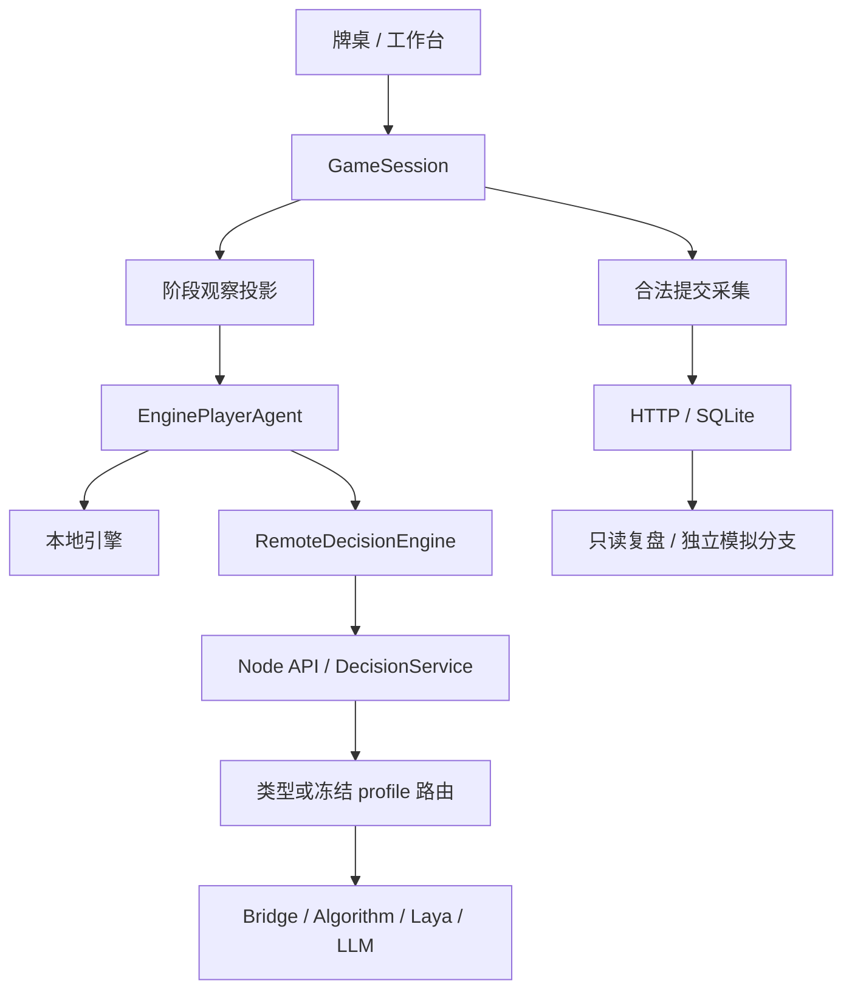

# 决策引擎架构

> 文档类型：当前实现说明；源码复核日期：2026-10-14。接口以链接的 TypeScript 定义为准，返回[文档索引](../README.md)。原架构研究报告见[历史版本](../archive/decision-engines-legacy.md)。

## 决策与保存路径

[GameSession](../../src/workbench/session.ts)管理合法动作、评估、请求失效与提交。牌局完整状态在客户端规则与会话层使用；[observeDecision](../../src/ai/decisionObservation.ts)和[observePlayer](../../src/ai/optimized/observation.ts)形成 AI 输入边界。[EnginePlayerAgent](../../src/ai/engines/engineAdapter.ts)执行决策、校验动作并记录诊断。

[server/apiHandler.ts](../../server/apiHandler.ts)由 Vite 内置中间件及独立 [proxy.ts](../../server/proxy.ts)共用，服务决策、配置、模型代理、历史与模拟。当前 Node 决策服务校验客户端观察和候选，但并不持有独立的权威牌局；多人权威对局服务属于[候选规划](../planning/future-directions.md)。

## 四类引擎与能力来源

| 类型 | 前三阶段 | 出牌 | 代码 |
| --- | --- | --- | --- |
| Bridge | 共用观察启发式 | fast 战术；deep 使用 DDS/PIMC 采样搜索 | [bridgeEngine.ts](../../src/ai/bridge/bridgeEngine.ts) |
| Algorithm | 共用观察启发式 | 约束采样、配对胜率搜索与有限信念残局 | [algorithmEngine.ts](../../src/ai/engines/algorithmEngine.ts) |
| Laya / System One | 叫分、定主调用模型；扣底启发式 | `/v1/systemone` 模型适配 | [layaEngine.ts](../../src/ai/engines/layaEngine.ts) |
| LLM | 模型支持叫分、定主、扣底 | OpenAI 兼容接口与合法动作解析 | [llmEngine.ts](../../src/ai/engines/llmEngine.ts) |

当前 `EngineType` 只有这四类，RL 仍是[研究候选](../planning/ai-research.md#m4--基于证据决定是否训练)，没有 RL 引擎实现。接口统一不代表各阶段均由模型执行，也不代表各引擎牌力已排序；证据见[评测覆盖](../ai/evaluation-coverage.md)与[历史结果](../ai/evaluation-results.md)。

Algorithm 的浏览器默认选择器为 Worker；Node 注册表与本地 profile 组合可注入不同选择器。搜索核、Worker 往返与 UI 等待的耗时需分别测量，历史延迟实验见[记录](../archive/ai-latency-20261010.md)。

## 接口与 RPC

[DecisionEngine](../../src/ai/engines/engineTypes.ts)以 `type` 标识引擎；`chooseCard` 接收 `PlayerObservation` 和只读 `Card[]` 候选，返回 `EngineDecision`。其他阶段使用 `DecisionObservation` 的联合类型，经 `chooseAction` 或阶段方法返回 `ActionDecision`。不把完整 `GameState` 传给具体引擎。

[DecisionRequest / DecisionResponse](../../src/ai/engines/decisionProtocol.ts)是 HTTP 契约的唯一类型定义：

- 请求阶段是 `bidding`、`trump`、`bury`、`playing`；包含 `seat`、`engineType` 和相应阶段观察，只有出牌请求另外包含 `candidates: Card[]`。
- profile 路由同时提供 `profileId` 与 `profileVersion`；可提供 `requestId`、`totalBudgetMs` 与流式开关 `stream`。旧类型路由保留兼容。
- 白名单重建观察和嵌套牌张，拒绝完整快照、座位不一致、非法候选及版本身份缺失；服务端再校验最终动作。
- 响应含 `success`、`action`、`engineType`、`latencyMs` 和 `executionEnvironment`；版本化路由记录请求/实际配置、回退链与动作来源。完整字段直接查看源码，不在文档维护第二份接口代码。

流式决策使用 SSE 进度与最终校验结果，客户端解析见 [eventStream.ts](../../src/ai/engines/eventStream.ts)。历史协议、SQL schema 和 profile 文件 schema 各自独立，定义及恢复边界见 [P0](../features/history-storage.md)、[P2](../features/engine-profiles.md)。

## 配置、预算与回退

[engineSettings.ts](../../src/ai/engines/engineSettings.ts)的旧默认配置使用 Bridge；浏览器默认开启服务端决策，Tauri 未显式配置服务时默认本地运行。LLM 旧默认超时是 60000 ms，Laya 是 1500 ms；实际生效值来自环境、profile 或用户设置，不能把默认值当作真实模型延迟。

[profiles.ts](../../src/ai/engines/profiles.ts)定义配置校验与不可变版本，[profileStore.ts](../../server/engines/profileStore.ts)管理配置文件，[注册表](../../server/engines/serverEngineRegistry.ts)按类型或版本创建引擎。四座选择、备用版本冻结和历史恢复见[配置说明](../features/engine-profiles.md)。

[DecisionService](../../server/services/decisionService.ts)把主调用和备用调用纳入同一总预算。旧类型路由默认备用为 Bridge；版本化 profile 按已冻结的备用链执行，缺少可用备用或整链失败时可以返回执行错误。客户端 [RemoteDecisionEngine](../../src/ai/engines/remoteEngine.ts)按所配置的本地备用处理服务失败；取消与总预算耗尽的边界须保留，不能保证任意故障下都成功出牌。

[safeAnySignal / abortable](../../src/ai/engines/engineTypes.ts)聚合取消信号、保留 reason，并提供清理；会话检查过期请求，迟到动作不能进入新局面。网络、模型、动作解析与执行失败分别记录，没有最终动作的失败不冒充已执行回退；唯一候选直接决策不计为模型调用。

## 信息隔离与验证入口

AI 只使用本阶段自己的手牌、合法已知底牌、公开牌、历史和公共状态。100 分合同只有成功扣底后才公开庄家搭档剩余手牌，并在后续观察中同步。透视和全牌复盘仅改变显示；SQLite 的完整状态和 seed 不能扩散到 AI。详细边界及回归证据见[信息隔离说明](information-isolation.md)。

相关行为回归位于 `tests/engine-fairness-isolation.test.ts`、`tests/server-decision.test.ts`、`tests/profile-routing.test.ts`、`tests/profile-boundaries.test.ts`、`tests/abort-signal.test.ts` 和历史/模拟测试。运行方法见[开发指南](../guides/development.md)；引擎扩展和默认替换另遵守 [AGENTS.md](../../AGENTS.md)及[统一评测](../ai/evaluation-plan.md)。
