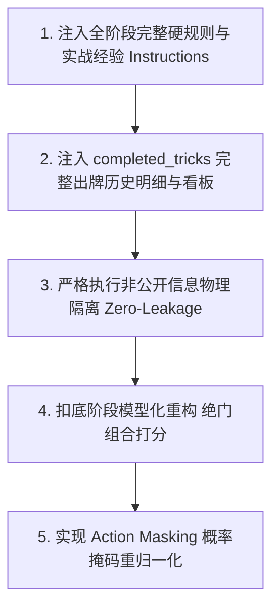

# 保山幺子分 · Laya 决策引擎演进与优化架构设计（第二版）

> 历史设计快照：2026-10-14 归档。原文问题表述、性能目标和实施步骤不是当前已验证缺陷或已交付承诺；当前候选见[Laya 演进设计](../design/laya-engine.md)，返回[归档索引](README.md)。

> **核心定位**：Laya 作为保山幺子分的**非自回归毫秒级判别决策核心**（基于 TypeSafe / Ollaya `/v1/systemone` 单步概率分类协议），专为高并发、低延迟（<100ms~300ms）及强化学习自博弈设计。
> 
> 本文档参考 LLM 的成熟设计，重点解决 Laya 引擎目前**缺少规则约束、丢失出牌历史、扣底未模型化**等硬伤，明确**“注入完整规则与专家经验”**、**“注入结构化历史出牌轨迹”**以及**“严格私有信息物理隔离（参考 LLM 零泄露准则）”**。

---

## 一、 现状剖析与核心痛点（对比 LLM 设计）

对比前序建立的 LLM 全生命周期架构，当前 Laya 实现（[`src/ai/engines/layaEngine.ts`](../../src/ai/engines/layaEngine.ts)）存在以下四大致命短板：

### 1. 规则与专家经验严重缺位（“不给规则，模型盲人摸象”）
* 目前发送给 `/v1/systemone` 的 `instructions` 只有一两句极其敷衍的提示（例如 `"根据保山幺子分规则，请在候选牌中选择最佳出牌："`）；
* **后果**：非自回归分类器完全不知道“有同门必须跟同门”、“A/10/5 才是分牌而 K/Q 为0分控牌”、“搭档稳赢时应垫小0分牌保牌或喂分”，只能依赖模型的泛化直觉或随机概率，决策质量低下。

### 2. 出牌历史记录彻底丢失（“丢失出牌历史，严重失忆”）
* 现有代码在 `statePayload` 中仅传入了 `completed_tricks_count: observation.completedRounds.length`（仅仅是一个数字！）；
* **后果**：模型完全看不到前序轮次中各家到底打出了什么牌、哪几张 A/10/5 已经被收走、谁在哪个花色上缺门断门、搭档是否用大主牌毙杀过，无法完成任何记牌与算断门推断。

### 3. 扣底阶段（`chooseBury`）完全伪实现
* 源码中直接硬编码调用本地规则 `smartBury(state, seat)`，**压根没有向 Laya 发起推断请求**，全生命周期完整性断裂。

### 4. 缺乏与 LLM 对齐的信息可见性边界（可能混淆公开与非公开信息）
* 必须确立与 LLM 相同的原则：**非公开暗牌绝对物理隔离，仅同步全场公共物理事件流**。

---

## 二、 核心铁律：规则全员统一，非公开信息绝对物理隔离（对齐 LLM 设计）

Laya 作为单步判别网络，同样运行于严格的不完全信息博弈环境中，必须严格遵守以下信息边界：

### 1. 规则与战术先验全员一致
* 四个座位的 Laya 推断请求，其 `instructions` 与基础规则体系**完全一致**（共享相同的牌力层级、分牌机制、跟牌铁律与行牌哲学）。

### 2. 私有信息绝对隔离（Zero-Leakage）
* **自己的手牌**：只能看到当前行动玩家自己的暗手牌；
* **对手与搭档暗手牌**：**绝对不可见**（绝不传入 `state` 中）；
* **底牌可见性**：
  * 叫分阶段：全员不可见（暗底）；
  * 定主阶段：全员不可见；
  * 扣底阶段：**仅庄家一人可见 4 张底牌**；闲家与搭档只能收到“庄家扣底完成”的公开抽象事件，**绝对无法窥视底牌内容**；
* **特殊公开明牌**：仅当叫满 100 分扣底后，庄家搭档按规则在桌面上摊开明牌，此时该明牌作为公开信息传入所有玩家的 `revealed_partner_hand` 中。

### 3. 允许传入的公开事实流
* **公开叫分流**：各家在叫分阶段公开喊出的分值或 Pass；
* **公开定主门类**：庄家定下的主牌门类（♠/♥/♣/♦）；
* **公开出牌历史轨迹（Completed Tricks）**：前序轮次各家依次打到桌面上的明牌、胜墩者、收走的分数；
* **公开断门推论**：根据历史出牌跟不出同门的物理事实，推导出的各家断门标记（`known_voids`）。

---

## 三、 四大阶段的 Instructions（规则 + 专家经验）注入设计

在 `/v1/systemone` 契约中，`questions[questionKey].instructions` 是模型的“System 级指导中枢”。我们将完整规则与专家经验系统化注入：

### 1. 叫分阶段 Instructions
```text
【保山幺子分·叫分决策指令】
游戏核心规则：四人两搭档（东西 vs 南北），52张无王，总分100分（仅A=10分, 10=10分, 5=5分，K/Q/J为0分）。发12张留4张暗底牌。最低起叫70分，步长5分，叫满100分扣底后搭档手牌必须对所有人明牌。
叫分实战经验：
1. 起叫(70-75分)：至少有1门5张以上长套带控制张(A/K)，手牌有基本分牌。
2. 冲高分(80-90分)：具备双大套或多张A控制牌，副牌短门有绝门毙杀潜力。
3. 叫满100分：单手牌极强或断门极好，并准备利用搭档明牌打双明手。
请根据你当前手牌的牌力、大牌点(HCP)与长套分布，在候选档位中做出最佳叫分选择（若牌力不足请果断选择 pass）：
```

### 2. 定主阶段 Instructions
```text
【保山幺子分·定主决策指令】
规则与地位：你是最高叫分成为庄家的选手，在看底牌前必须从四门花色中选定一门为主牌。主牌压过任何非主牌。
定主实战经验：
1. 绝不定短门为主！优先选择张数最多（通常≥5张）且牌力结构完整（有A、K控场）的花色为主牌。
2. 确保后续行牌具备拔大清主和绝对控场权，保护副牌长套兑现得分。
请评估四门花色长度与控制力，选择最佳主牌花色：
```

### 3. 扣底阶段 Instructions（模型化重构）
```text
【保山幺子分·扣底决策指令】
规则红线：庄家拿进4张底牌后手牌变为16张，必须扣回恰好4张非分底牌！分牌（A、10、5）严禁扣底，否则判负！
扣底实战经验：
1. “扣短不扣长，造绝门用主杀”：副牌中仅有1~2张小牌的短门是绝佳扣牌目标，将该门直接扣空（造成绝门），一旦对手出该门即可立即用主牌毙杀吃大分！
2. 保护长套大牌与主牌，严禁削弱自身的赢墩控制能力。
请从下列合法非分扣底策略组合中，选择收益最大的扣底方案：
```

### 4. 出牌阶段 Instructions
```text
【保山幺子分·出牌决策指令】
游戏跟牌铁律：同门大小 A > K > Q > J > 10 > 9 > 8 > 7 > 6 > 5 > 4 > 3 > 2。全副仅 A(10分)、10(10分)、5(5分)为分牌，K/Q/J为0分控牌。有同门必须跟同门；缺门可主牌毙杀或垫副牌。
高水平出牌实战经验：
1. 搭档协同原则：当搭档打出的牌已确定稳赢本轮时：
   - 手中有分牌且安全时，果断【喂分】（跟出同门10/5或垫其他门大分送入己方账目）；
   - 手中无分牌时，【出最小0分牌保牌】（如2、3、4），严禁无收益消耗己方高控制牌（如K、Q）。
2. 敌强我弱防守：对手大牌稳赢时，绝不主动送分，尽量跟小牌或保留主牌控制力。
3. 领出主动权：己方优势时优先拔大牌清扫对手阻碍主牌；建立长套通路。
请结合已打出的历史轮次明细与各家断门，从合法候选牌中选择最优出牌：
```

---

## 四、 状态表征升级：完整出牌历史与公开看板 Payload 规范

解决“失忆”问题，在 `state` 中完整提供**结构化已出牌轨迹**与**公开记牌看板**：

```json
{
  "model": "laya:multilingual",
  "state": {
    "game": "baoshan_yaozifen",
    "phase": "playing",
    "seat": 0,
    "seat_name": "东家",
    
    // 1. 私有信息：仅当前玩家自己的手牌（严格隔离）
    "own_hand": ["♠K", "♠Q", "♠10", "♠4", "♦9"],
    
    // 2. 规则公开信息：若叫满100分，搭档手牌在桌面上公开；否则为 null
    "revealed_partner_hand": null,
    
    // 3. 局势公开基本盘
    "trump": "S",
    "declarer": 0,
    "bid": 85,
    "declarer_side": "东西方",
    "my_side": "东西方",
    "scores": {
      "declarer_collected": 35,
      "defender_collected": 15,
      "declarer_target": 85,
      "defender_lock_target": 20
    },

    // 4. 【关键补充】完整历史出牌记录（Completed Tricks）
    "completed_tricks": [
      {
        "trick_number": 1,
        "leader": 0,
        "cards": [
          { "seat": 0, "card": "♠A", "points": 10 },
          { "seat": 1, "card": "♠2", "points": 0 },
          { "seat": 2, "card": "♠5", "points": 5 },
          { "seat": 3, "card": "♠8", "points": 0 }
        ],
        "winner": 0,
        "points_collected": 15
      },
      {
        "trick_number": 2,
        "leader": 0,
        "cards": [
          { "seat": 0, "card": "♥A", "points": 10 },
          { "seat": 1, "card": "♥3", "points": 0 },
          { "seat": 2, "card": "♥10", "points": 10 },
          { "seat": 3, "card": "♥K", "points": 0 }
        ],
        "winner": 0,
        "points_collected": 20
      }
    ],

    // 5. 【关键补充】公开记牌看板（帮助非自回归小模型快速感知全场状态）
    "card_accounting": {
      "total_points_played": 35,
      "total_points_remaining": 65,
      "played_point_cards": ["♠A", "♠5", "♥A", "♥10"],
      "remaining_point_cards_count": 8
    },

    // 6. 公开推断的已知断门表
    "known_voids": {
      "east": [],
      "south": [],
      "west": ["C"],     // 西家在梅花门垫了牌，梅花已绝门！
      "north": []
    },

    // 7. 当前正在进行的轮次
    "current_trick": [
      { "seat": 1, "card": "♥Q", "points": 0 }
    ]
  },
  "questions": {
    "play": {
      "type": "choice",
      "instructions": "<注入上述完整规则与出牌实战经验>",
      "criteria": {
        "KS": "♠K (主牌杀, 0分)",
        "QS": "♠Q (主牌杀, 0分)",
        "10S": "♠10 (主牌杀, 10分)",
        "4S": "♠4 (主牌杀, 0分)",
        "9D": "♦9 (垫方块副牌, 0分)"
      }
    }
  }
}
```

---

## 五、 扣底阶段（Bury）模型化方案落地

为解决原代码直接调用本地规则的缺陷，采用**“绝门收益组合打分网络”**方案：

1. **预处理**：从庄家 16 张手牌中筛选出所有非分牌；
2. **战术聚类**：根据制造绝门的收益，自动生成 3~5 组最具战略意义的 4 张非分牌组合（如“扣尽梅花组”、“扣尽方块组”、“修剪副牌组”）；
3. **向 Laya 发起评估**：
```json
{
  "questions": {
    "bury_target": {
      "type": "choice",
      "instructions": "<注入完整扣底规则与短门绝杀战术经验>",
      "criteria": {
        "C_clear": "组合A: 扣除 [♣6, ♣3, ♣8, ♦2] (将梅花彻底扣空绝门，保留主牌大套)",
        "D_clear": "组合B: 扣除 [♦2, ♦3, ♣6, ♣3] (将方块彻底扣空绝门，保留长套梅花)",
        "H_trim":  "组合C: 扣除 [♥7, ♥3, ♥9, ♣3] (修剪红心副牌，保留梅花和方块)"
      }
    }
  }
}
```
4. **硬性规则校验保底**：无论模型选择哪组，代码层必须执行断言校验（`cards.length === 4 && 所有牌分值为 0`），双重确保零违规。

---

## 六、 动作概率掩码（Action Masking）机制

利用 Laya 返回的 `probabilities`（全概率分布），进行数学上的严格重标定，彻底解决非法候选报错：

$$P_{\text{masked}}(c) = \begin{cases} \frac{P(c)}{\sum_{c' \in \text{Legal}} P(c')}, & c \in \text{Legal} \\ 0, & c \notin \text{Legal} \end{cases}$$

```typescript
// 1. 获取模型返回的概率分布
const probs: Record<string, number> = json.answers?.play?.probabilities ?? {};

// 2. 仅在合法候选牌集内挑选概率最大者 (Argmax over Legal Cards)
let bestCard: Card | null = null;
let maxProb = -1;

for (const c of candidates) {
  const id = cardId(c);
  const p = probs[id] ?? 0;
  if (p > maxProb) {
    maxProb = p;
    bestCard = c;
  }
}

// 3. 若模型未给出有效概率分布，兜底使用 choice 字段或合法集首张
const finalCard = bestCard ?? candidates.find((c) => cardId(c) === json.answers?.play?.choice) ?? candidates[0];
```

---

## 七、 实施演进路线图



1. **第一步：重构 Instructions**  
   将叫分、定主、扣底、出牌四阶段的 System 级规则与特级大师行牌哲学编写进标准常量模块；
2. **第二步：补全出牌历史与看板表征**  
   改造 `statePayload`，补齐每一轮的出牌记录、得墩归属、得分统计与剩余分牌监控；
3. **第三步：严格审计信息隔离**  
   严格禁止在 `statePayload` 中放入任何未公开信息（非自己的暗牌、非庄家的底牌）；
4. **第四步：扣底模型化上线**  
   废除硬编码 `smartBury`，接入组合打分网络；
5. **第五步：上线动作概率掩码**  
   基于概率分布执行安全过滤与 Softmax 重归一化，保证 100% 合法且不报错。
