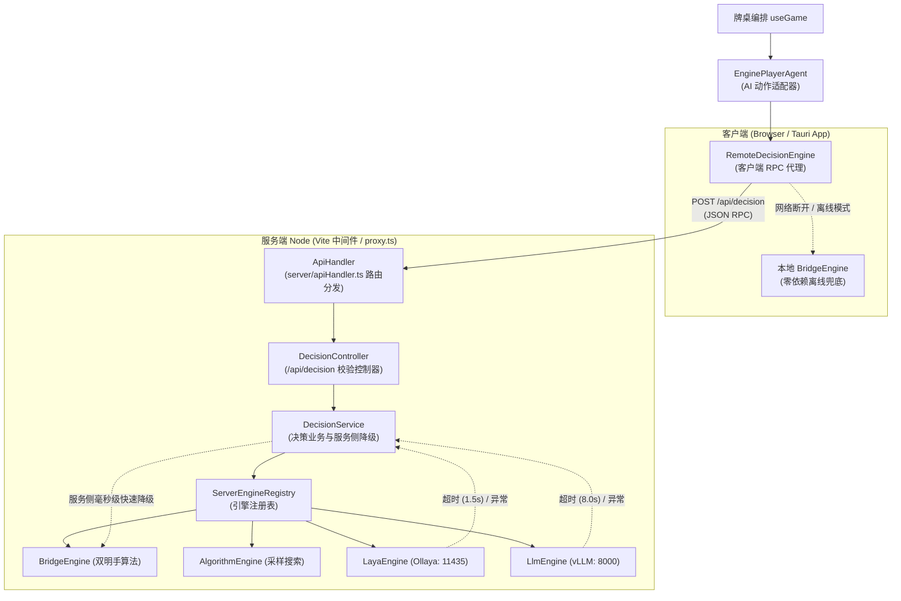

# 保山幺子分决策引擎架构与算法研究报告

## 1. 架构设计与 SOLID 原则

为支持在牌桌中实时无缝切换不同 AI 决策体系（桥牌启发式深度思考、传统搜索算法、非自回归小模型、大语言模型以及自训强化学习），并杜绝浏览器直接访问模型时的网络阻断与中止异常，系统对 AI 决策模块进行了全面重构，建立了一套严格遵循 SOLID 面向对象设计原则的 Client/Server 决策架构：

- **单一职责原则 (Single Responsibility Principle, SRP)**：
  - `RemoteDecisionEngine` (客户端)：专注于决策请求的 RPC 序列化、网络传输以及在离线或服务端故障时的客户端平滑降级；
  - `DecisionController` (服务端)：专注于 `/api/decision` HTTP 路由层、入参合法性校验与响应状态码封装；
  - `DecisionService` (服务端)：专注于全阶段决策路由分发、超时控制与服务端进程内毫秒级平滑降级（模型异常时由服务端 `BridgeEngine` 接管）；
  - `ServerEngineRegistry` (服务端)：专注于服务端决策引擎实例生命周期管理与热重载；
  - `safeAnySignal`：专注于跨浏览器与 Node 环境汇聚多个取消信号，完整保留初始取消原因（`reason`），从根源杜绝空参数 abort 引发的 `signal is aborted without reason` 报错；
  - `PlayerObservation`：只负责合法已知信息的投影与隔离，绝不泄露暗牌；
  - `tactics.ts` (`isPartnerGuaranteedWinning` / `pruneCandidates`)：只负责搭档稳赢状态评估与无收益牌精简；
  - `WorkerCardSelector` / `PairedCardSelector`：只负责约束采样与配对胜率搜索；
  - `LayaEngine` / `LlmEngine`：只负责各自模型协议格式的转换与通信；
  - `EnginePlayerAgent`：只负责将牌桌生命周期各阶段（叫分、定主、扣底、出牌）转接至当前激活的决策引擎；
  - `engineSettings.ts`：只负责引擎配置的结构定义、校验与 localStorage 持久化；
  - `DecisionLogger`：只负责决策日志采集、指标隔离存储与 JSON 导出。
- **开闭原则 (Open-Closed Principle, OCP)**：
  - 核心牌桌 `useGame` 与界面只依赖 `PlayerAgent` 抽象，无需感知具体的决策运行位置（客户端本地 vs 远程服务端）；
  - 新增任何决策引擎（如自训 RL 模型）或扩展新的博弈阶段，只需在 `DecisionEngine` 接口及服务端注册表中新增对应实现，无需变动牌桌交互、规则引擎或对局编排逻辑。
- **里氏替换原则 (Liskov Substitution Principle, LSP)**：
  - 客户端 `RemoteDecisionEngine` 与本地的 `BridgeEngine`、`AlgorithmEngine`、`LayaEngine`、`LlmEngine` 均实现统一的 `DecisionEngine` 契约；
  - 所有引擎均保证在给定合法候选动作空间时，输出合法的决策动作；任何引擎均可在不破坏对局合法性的前提下随时互相替换，甚至在发生异常时透明热替换。
- **接口隔离原则 (Interface Segregation Principle, ISP)**：
  - 领域层提供粒度清晰的阶段特化方法（`chooseBid`, `chooseTrump`, `chooseBury`, `chooseCard`），各阶段只传递该阶段所需的动作候选集；
  - 跨端通信通过 `decisionProtocol.ts` 规范严格隔离各阶段的 Payload 类型（`BidPhasePayload`, `TrumpPhasePayload`, `BuryPhasePayload`, `PlayingPhasePayload`），避免调用方依赖冗余数据；
  - 搜索胜率（`searchWinRate`）与模型概率（`probabilities`）分别记录，不混用不同语义的指标。
- **依赖倒置原则 (Dependency Inversion Principle, DIP)**：
  - 牌桌循环与服务端控制器均依赖抽象协议 `DecisionEngine` 与 `decisionProtocol`，具体实现通过依赖注入挂载，完全解耦了调用方与具体算法/网络部署形态。

---

## 2. 核心战术策略改进：搭档保牌与候选精简

### 2.1 问题背景
在实际对局中（例如经典局面：西家领出最大主牌 ♦A、北家跟 ♦J，东家持 ♦K 与 ♦2）：
- 保山幺子分中，分牌只有 **A (10分)**、**10 (10分)**、**5 (5分)**；
- **K、Q、J 均为 0 分牌**；
- 此时西家搭档出 ♦A 已经确定稳赢该轮吃分，东家出 ♦K 既无法额外拿分，又浪费了一张之后可以用作领出权控制的高牌力大牌。

### 2.2 解决方案
1. **搭档稳赢判定 (`isPartnerGuaranteedWinning`)**：
   - **第四手**：当前已有 3 张出牌，自己是最后一家，只要自己不超车搭档必赢；
   - **最大主牌**：搭档出主牌，且场上所有未见牌与已知明牌中没有更大的主牌；
   - **副牌领出**：搭档副牌当前最大，且确认同门未见牌无更大张，同时排除后手对手绝门杀牌的风险。
2. **战术候选精简 (`pruneCandidates`)**：
   - 当搭档确定稳赢时，将同门、零分、不改变赢家的候选牌合并为**点数最小的牌**（保留 ♦2，排除无收益的 ♦K 消耗）；
   - 分牌（A/10/5，可用于安全喂分）和能改变赢家的超车牌继续保留，供深度搜索或收益模型做进一步评估。

---

## 3. 胜负锁定与提前结算机制

- **触发条件**：在基础计分规则（`basicScoring`）下，四家出完入账后实时判定：
  - 庄家方总吃分（出牌吃分＋底牌分）达到叫分 $B$；
  - 闲家方总吃分达到 $105 - B$（此时庄家方理论最多只能拿 $100 - (105 - B) = B - 5$ 分，已无法成局）；
    - 该推导成立的前提：底牌分只并入庄家方（`basicScoring`），闲家吃分 $D$ 为纯出牌吃分；分数只能以 5 为单位累加（A/10=10、5=5），故 $D$ 恒为 5 的倍数。
    - 由此 $105 - B$ 是**精确**阈值而非保守估计：$D > 100 - B$ 与 $D \ge 105 - B$ 在所有可达局面上等价，$101 - B$ 落在两个可达分值之间（如 $B=70$ 时 31，而 $D$ 只能取 30 或 35），永不被触达。请勿改为 $101 - B$。守护测试见 `tests/early-finish-threshold.test.ts`。
- **结算展示**：
  - 结算弹窗展示“⚡ 提前锁定胜负”金色徽章；
  - 剩余未打出的分牌计入 `unplayedPoints`，并在战报中单独列出；
  - 各玩家剩余手牌完整保留；
  - 分数守恒关系更新为：
    $$\text{庄方吃分} + \text{闲方吃分} + \text{底牌分} + \text{未打出分} = 100$$
- **扩展性**：自定义计分策略（如未来引入的抠底翻倍策略）继续打满 12 轮。

---

## 4. 五类决策引擎对比与参数体系

| 引擎类型 | 技术架构与接口 | 典型延迟 | 特点与优势 | 异常应对 |
|---|---|---|---|---|
| **桥牌启发式深度思考 (Bridge)** | 纳秒级位棋盘 + 双明手 Alpha-Beta 极小化极大搜索 (DDS) + 桥牌战术库 | ~150 - 220 ms | 默认算法引擎。零模型依赖，纯算法高胜率；精通拔主、兑现赢张、安全喂分与第四手便宜拿 | 超出预算自适应回退到保牌基线 |
| **传统采样搜索 (Algorithm)** | Web Worker 独立线程，约束采样 + 配对胜率搜索 + 信念残局求解 | ~250 ms | 无需外网或外部进程，纯前端运行，严格数学逻辑保障 | 超出预算自适应回退到保牌基线 |
| **非自回归模型 (Laya)** | TypeSafe `/v1/systemone` 接口适配，默认模型 **`laya:multilingual`**（支持中文） | ~170 - 250 ms | 单步推断极快，`output_tokens: 0`，并行概率打分与动作选择 | 默认超时 1.5s，服务侧秒级降级至 Bridge 引擎 |
| **大语言模型 (LLM)** | OpenAI 兼容 Chat Completions，适配 vLLM 与 DeepSeek；默认模型 **`qwen38_27b`** | ~1 - 5 s | 具备深厚策略常识，JSON 严格结构化输出；支持思考等级 `reasoning_effort` 调节 | 默认超时 8s，服务侧秒级降级至 Bridge 引擎 |
| **自训强化学习 (RL)** | *研发中*：PerfectDou / Team-PSRO 架构，ONNX 格式导出接入 | ~10 - 50 ms | 专门针对保山幺子分团队博弈自对弈训练，极高牌力上限 | 由适配器统一防护非法牌与动作掩码 |

### 4.1 大语言模型思考等级 (`reasoning_effort`) 规范
在 OpenAI 规范与 vLLM（如部署的 Qwen / QwQ / DeepSeek 系列推理模型）中，通过 `reasoning_effort` 参数控制内部思维链深度：
- `default`：默认档位，由模型端策略自适应决定，客户端传递标准 `temperature: 0.1`；
- `none`：显式关闭思考链，以最高速度生成结构化选牌；
- `low`：低思考深度，消耗少量 token，在快速响应的同时具备基础战术逻辑；
- `medium`：中等思考深度，在延迟与胜率间保持平衡；
- `high`：高思考深度，进行充分的多步手牌与胜负推演。

> 当设置非 `default` 的思考等级时，请求体会自动省略采样温度参数（`temperature`），避免触发推理模型对显式温度参数的 400 校验限制。

---

## 5. 本地服务部署与运行指南

### 5.1 启动 Ollaya Laya 推理服务（本地）
```bash
# 1. 启动 Ollaya 守护服务（默认监听 127.0.0.1:11435）
~/.local/bin/ollaya serve

# 2. 检查模型状态（确保包含多语言中文模型 laya:multilingual）
~/.local/bin/ollaya list
# 包含 laya:multilingual
```

### 5.2 启动方式一：单命令极速开发（推荐：单命令合一）
```bash
# 启动统一开发服务器（Vite 内置全功能决策与代理中间件，默认 http://localhost:5173）
# 前端牌桌界面与 /api/decision、/api/engines 统一在 5173 端口提供，无需单独开终端启动代理！
pnpm dev

# 支持通过环境变量注入上游与密钥（解决浏览器跨域与鉴权保护）：
LAYA_BASE_URL=http://127.0.0.1:11435 \
LAYA_MODEL=laya:multilingual \
LLM_BASE_URL=http://127.0.0.1:8000/v1/ \
LLM_MODEL=qwen38_27b \
pnpm dev
```

### 5.3 启动方式二：前后端解耦双终端启动（独立后端与客户端）
适合希望在独立终端观察决策 RPC、模型转发与延迟诊断日志的场景：

```bash
# 终端 1：启动决策与模型代理（自动加载 .env 中的专属 GPU 节点与配置，默认端口 3001）
pnpm server

# 终端 2：启动前端客户端开发界面（Vite 代理反向连接 pnpm server）
pnpm client
```

### 5.4 牌桌设置面板与模型配置
打开浏览器牌桌后：
1. 点击右侧工具栏的 **“AI 引擎 · [当前引擎]”** 按钮打开配置弹窗；
2. 在 **“AI 决策引擎与模型服务配置”** 中：
   - 切换当前生效引擎（传统算法 / 非自回归模型 / 大语言模型）；
   - 自定义配置 vLLM 的 `openai_api_base`（默认 `http://127.0.0.1:8000/v1/`）与 `model_name`（默认 `qwen38_27b`）；
   - 调节 **思考等级 (`reasoning_effort`)**（默认 / 关闭 / 低 / 中 / 高）；
   - 配置 TypeSafe 服务端点与模型名（默认 `laya:multilingual`）；
   - 点击 **“测试 LLM 连通性”** 或 **“测试 TypeSafe 连通性”** 实时诊断握手延迟；
   - 点击 **“💾 保存并应用配置”** 立即持久化至 `localStorage` 并应用到对局中。

---

## 6. Client/Server 决策服务架构与通信规范

### 6.1 背景与设计动机
在纯前端 Web 牌桌中直接由浏览器调用本地/远程模型服务时，面临四大关键痛点：
1. **Chrome 私有网络访问限制 (Private Network Access, PNA)**：从 `http://localhost:5173` 或局域网地址请求本地 `127.0.0.1:11435` 时，现代 Chromium 浏览器出于安全策略会触发预检或直接阻止请求；
2. **跨域资源共享 (CORS) 阻断**：多数模型推理容器未配置宽松的 CORS 头，导致前端网络请求被直接拦截；
3. **冷启动与网络延迟抖动**：轻量级非自回归模型（如 Ollaya）在闲置被唤醒时存在数百毫秒加载延迟，容易被前端紧凑的客户端超时控制器直接掐断；
4. **AbortSignal Reason 丢失报错**：浏览器 `AbortController.abort()` 若未传递明确的错误实例，现代浏览器内核会抛出 `AbortError: signal is aborted without reason`，造成不可控的非结构化异常。

为此，系统构建了符合 SOLID 原则的 **Client/Server 决策服务架构**，将外部推理服务的网络连接与鉴权收敛到 Node 后端，同时客户端与服务端具备全阶段毫秒级双重优雅降级能力。

### 6.2 架构拓扑与数据流向

为了兼顾开发体验与部署灵活性，服务端路由与请求分发核心被封装为零依赖的 `server/apiHandler.ts`：
- **开发环境**：由 `vite.config.ts` 中的 Connect 中间件在 5173 端口拦截挂载 `/api/*`，单命令 `pnpm dev` 即可运行全功能应用；
- **独立部署**：由 `server/proxy.ts` 复用相同的处理器，在独立端口（默认 3001）提供独立的无头服务。



### 6.3 统一 RPC 决策契约 (`decisionProtocol.ts`)

客户端与服务端通过强类型 TypeScript 接口进行通信，契约同时兼容四个游戏博弈阶段：

#### 请求结构 (`DecisionRequest`)
```typescript
export interface DecisionRequest {
  phase: DecisionPhase;               // 'bidding' | 'declaring' | 'burying' | 'playing'
  observation: PlayerObservation;     // 当前玩家可见观察投影
  engine?: EngineType;                // 目标引擎: 'bridge' | 'algorithm' | 'laya' | 'llm'
  timeoutMs?: number;                 // 最大容忍超时 (毫秒)
  
  // 阶段候选空间（按当前阶段提供）
  legalBids?: number[];               // 叫分候选: [70, 75, ..., 0]
  legalTrumps?: CardSuit[];           // 定主候选: ['S', 'H', 'C', 'D']
  legalDiscards?: CardId[][];         // 扣底候选组合
  legalCards?: CardId[];              // 出牌候选: ['AS', '10S', ...]
}
```

#### 响应结构 (`DecisionResponse`)
```typescript
export interface DecisionResponse {
  action: ActionDecision;             // 统一通用动作结构
  chosenBid?: number;                 // 叫分结果
  chosenTrump?: CardSuit;             // 定主结果
  chosenBury?: CardId[];              // 扣底结果 (4张)
  chosenCard?: CardId;                // 出牌结果 (单张)
  
  engine: EngineType;                 // 最终生效引擎
  requestedEngine: EngineType;        // 原始请求引擎
  fallbackEngine?: EngineType;        // 若发生降级，标记降级引擎
  fallbackReason?: string;            // 降级详细原因
  latencyMs: number;                  // 总耗时 (毫秒)
  metadata?: Record<string, unknown>; // 诊断指标与模型打分
}
```

---

## 7. 全阶段 AI 决策体系 (All-Phase AI Decision Lifecycle)

过去 AI 体系多聚焦于出牌（Trick Play）阶段，叫分、定主与扣底往往依赖简单固定规则。重构后的决策引擎全面实现了对局四个核心阶段的策略输出：

### 7.1 各博弈阶段策略模型
1. **叫分阶段 (`bidding`)**：
   - 候选空间：`[70, 75, 80, 85, 90, 95, 100, 0]`（0 表示不叫/Pass）；
   - 策略逻辑：评估起手 12 张手牌的大牌点数 (HCP)、主牌长套长度与控制张分布。手牌实力充沛时主动叫高分，甚至在具备绝对控牌力时冲击 100 分触发搭档明牌机制；
2. **定主阶段 (`declaring` / `trump`)**：
   - 候选空间：四门花色 `['S', 'H', 'C', 'D']`；
   - 策略逻辑：计算各门花色的牌张数量、大牌集中度（A、K、10）与期望将吃控制力，选定能够发挥全队最大赢张期望的主牌花色；
3. **扣底阶段 (`burying`)**：
   - 候选空间：从庄家进底后的 16 张手牌中选出 4 张非分牌扣入底牌；
   - 策略逻辑：严格校验 **A、10、5 禁止扣底**；策略上优先塑造副牌绝门以形成将吃（杀牌）机会，保留高牌力长套副牌与全部主牌，将分散且无法赢墩的低小散牌安全扣入底牌；
4. **出牌阶段 (`playing`)**：
   - 候选空间：本轮满足同门必跟约束的合法候选牌；
   - 策略逻辑：桥牌专家战术（第二手出小、第三手争墩/喂分、第四手便宜拿）、搭档稳赢候选精简、双明手 DDS Alpha-Beta 搜索与成局线硬截断。

### 7.2 核心接口定义 (`engineTypes.ts`)
```typescript
export interface DecisionEngine {
  readonly id: EngineType;
  readonly name: string;
  readonly description: string;

  // 阶段特化方法
  chooseBid(obs: PlayerObservation, legalBids: number[], signal?: AbortSignal): Promise<number>;
  chooseTrump(obs: PlayerObservation, legalTrumps: CardSuit[], signal?: AbortSignal): Promise<CardSuit>;
  chooseBury(obs: PlayerObservation, legalDiscards: CardId[][], signal?: AbortSignal): Promise<CardId[]>;
  chooseCard(obs: PlayerObservation, candidates: CardId[], signal?: AbortSignal): Promise<CardId>;

  // 全阶段统一调度入口
  chooseAction?(request: DecisionRequest, signal?: AbortSignal): Promise<DecisionResponse>;
}
```

---

## 8. 健壮性保障与安全取消信号链 (safeAnySignal)

### 8.1 现代浏览器中的 AbortSignal 陷阱与根因分析
在调试 Laya 与 LLM 引擎时，控制台偶发出现如下堆栈：
```
AbortError: signal is aborted without reason
    at s.addEventListener.once (layaEngine.ts:127:50)
```
深入排查发现两大根因：
1. **空参中止**：当外部调用 `controller.abort()` 而未显式传入错误参数时，WHATWG 规范默认生成 `AbortError: signal is aborted without reason`；
2. **信号汇聚丢弃 Reason**：在聚合客户端传入的外部取消信号与内部超时定时器时，简易事件监听器仅触发了子控制器的 `abort()`，未将原始信号的 `s.reason` 透传；

### 8.2 安全信号聚合器 (`safeAnySignal`)
系统在 `src/ai/engines/engineTypes.ts` 中实现了工业级安全的 `safeAnySignal` 工具函数：

```typescript
export function safeAnySignal(signals: (AbortSignal | undefined | null)[]): AbortSignal {
  const activeSignals = signals.filter((s): s is AbortSignal => Boolean(s));
  // 1. 若已有信号已触发中止，直接提取 reason，无 reason 时补充具名 TimeoutError
  for (const s of activeSignals) {
    if (s.aborted) {
      const reason = s.reason ?? new DOMException('Operation timed out or aborted', 'TimeoutError');
      return AbortSignal.abort(reason);
    }
  }

  // 2. 动态监听所有源信号，捕获首个触发事件并严格传递 reason
  const controller = new AbortController();
  const onAbort = (ev: Event) => {
    const target = ev.target as AbortSignal | null;
    const reason = target?.reason ?? new DOMException('Operation aborted by caller', 'AbortError');
    controller.abort(reason);
    cleanup();
  };
  // ... 清理监听器以防内存泄露
  return controller.signal;
}
```
通过此实现，上游超时的报错始终为标准的 `TimeoutError: ...`，杜绝了未知原因的异常崩溃。

### 8.3 双重优雅降级闭环 (Two-Tier Graceful Degradation)
1. **第一层：服务端进程内毫秒级降级**：
   - 当用户在前端配置使用 `laya` 或 `llm` 时，请求先到达 Node 服务端 `DecisionService`；
   - 若模型上游不可达（如 502 Bad Gateway）、网络超时（Laya 1.5s / LLM 8s）或返回非法决策，服务端立即调度内存中的 `BridgeEngine`；
   - 降级在服务端进程内完成，耗时仅数毫秒，返回包含 `fallbackEngine: 'bridge'` 的标准成功响应，避免前端发起重试请求增加网络延迟；
2. **第二层：客户端离线降级**：
   - 若本地开发未启动 `pnpm proxy`，或用户在离线环境（如移动端纯单机 App）中游玩，`RemoteDecisionEngine` 在网络请求失败后自动捕获错误；
   - 客户端立即在浏览器线程直接调度本地 `BridgeEngine` 接管决策，并在决策日志中记录降级原因；
   - 对局 100% 不受影响，保障了从单机无网环境到高配大模型服务器的平滑过渡。

---

## 9. 项目维护与二次开发指南

### 9.1 快速测试与质量门禁
本项目遵循严谨的测试驱动开发规范，提交代码前需确保全部静态检查与单元测试通过：

```bash
# 1. 运行全部单元与集成测试（14 个套件，147 项测试全部通过）
./node_modules/.bin/vitest run

# 2. 运行 TypeScript 严格类型检查（0 错误）
./node_modules/.bin/tsc --noEmit

# 3. 运行生产打包构建验证（构建产物完整）
pnpm build
```

### 9.2 如何扩展新的决策引擎（如自博弈强化学习 RL）
若需接入训练好的强化学习 ONNX 模型：
1. **实现客户端/服务端引擎接口**：
   在 `src/ai/engines/` 或 `server/engines/` 中创建 `rlEngine.ts`，实现 `DecisionEngine` 接口：
   - 构造合法动作空间掩码 (Action Masking)；
   - 将 `PlayerObservation` 转换为张量特征输入；
   - 运行 ONNX 运行时推理，输出各动作预测概率；
2. **在注册表中挂载**：
   - 服务端：在 `server/engines/serverEngineRegistry.ts` 中注册新引擎并加入选择分支；
   - 前端：在 `src/ai/engines/engineSettings.ts` 中的 `EngineType` 联合类型中增加 `'rl'`，并在 `EngineSettingsModal.tsx` 中增加 UI 选项；
3. **编写回归测试**：
   - 在 `tests/engines.test.ts` 中增加合法性校验、单候选直接出牌与异常回退测试用例。
