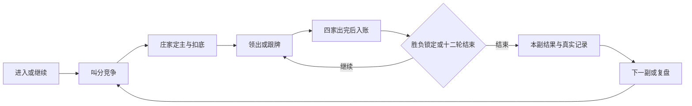

# 保山幺子分 · 游戏产品设计

> 文档类型：产品设计；设计日期：2026-10-14。已接入与待实现分别标明；任务状态见开发路线。返回[文档索引](../README.md)。

版本：0.2 · 2026-10-14 · 状态：设计稿与首批体验接入。

本稿应用项目内 [Product Manager Toolkit](../skills/product-manager-toolkit.md) 的 PRD、用户任务、MoSCoW 和假设验证方法。设计依据为当前代码、README、开发路线与用户已确认的“交互方案 + 可点击原型、Debug、桥牌产品参考”。已完成设计、skill 安装、普通牌桌 / Debug 首批 UI、单副练习、结算直接复盘及短教学首批两段，详见[接入与验证记录](../ui/implementation-validation.md)与[开发路线](../planning/development-roadmap.md)；其余教学与真实玩家任务观察仍待推进。

## 1. 产品定位与要解决的问题

让玩家快速进入一副幺子分，清楚地与搭档争取分牌，理解成局或破庄的原因，再用真实记录复盘提高判断。核心体验是四人搭档的合同风险、领出权与吃分配合。产品同时支持普通游玩和可解释的 AI 研究，但普通玩家的主要入口使用玩法语言。

目前已经可以完整打牌、存档、复盘和比较配置。要改善的是这些能力的组织：初次接触的玩家需要在当前阶段知道“轮到谁、能做什么、为什么”；熟练玩家需要迅速继续；复盘和 Debug 用户需要控制节奏并追溯真实动作。

**证据边界**：功能现状可由代码核对；“新手容易理解”“结算能促成复盘”“单副练习更适合短时游玩”都是设计假设。当前没有真实用户访谈、任务完成率、留存和市场规模数据。本稿不以这些假设宣称已验证的需求收益。

| 用户任务 | 当前情况与依据 | 设计机会 |
| --- | --- | --- |
| 顺利完成第一副 | 已有完整阶段控制、规则弹窗和合法牌反馈：`ControlPanel`、`RulesModal`、`HumanHand` | 增加阶段内教学，先让玩家完成一次合法动作 |
| 按自己的节奏玩 | 默认先胜 5 副、确认设置与速度：`DEFAULT_RULES`、`GameTools` | 提供单副练习入口，标准局保留默认目标 |
| 看懂胜负 | `HandResultModal` 展示合同、吃分、提前结算、余分与胜副 | 先说获胜方和锁定原因，再给下一副 / 复盘动作 |
| 从错误中学习 | 历史、节点复盘、分支、模拟报告已实现 | 把当前结算与具体副牌复盘直接连通，减少寻找成本 |
| 可控调试 | `SquareTable`、`DebugSidePanel`、`useGame` 已有完整工作台 | 与普通玩法共用牌桌语言，保留五页诊断和信息隔离 |

不做改动的主要代价目前只能定性判断：新手仍需自行组合规则，玩家需要在多个入口之间寻找结果和诊断。量化收益待任务观察后补充。

## 2. 目标玩家与用户任务

以下是待访谈校验的用户分组，不虚构年龄、人数或付费意愿。

| 分组 | 情境与任务 | 体验标准 |
| --- | --- | --- |
| 新手 | 当我第一次接触幺子分，我想完成一副并理解分牌、跟门和成局，让我能继续与 AI 玩 | 在当前阶段得到必要解释，练习可跳过，不要求读完长规则 |
| 熟练玩家 | 当我有空想打一局，我想快速开始或继续，与搭档争取胜副 | 默认选择可用，操作及时，确认与速度可调 |
| 观战 / 复盘者 | 当我想看懂一次决策，我想逐步查看公开动作和当时观察，比较另一种打法 | 暂停、下一步、上一轮与结果定位清楚；原路径保留 |
| Debug 用户 | 当我需要复现异常，我想暂停、查四座、审查候选和请求、撤销恢复 | 提示与执行分开，所有诊断绑定当前游标，临时看牌不进入 AI |

首轮验证优先观察新手和熟练玩家；Debug 是用户明确要求保留的能力，随体验改造一起验收。

## 3. 游戏体验与决策循环

### 3.1 核心循环

每层反馈回答一个问题：选牌反馈告诉玩家“这张已选”；本轮反馈告诉玩家“谁拿走了哪些分”；本副结果告诉玩家“哪个目标被达到”；整场比分告诉玩家“还差几副获胜”。吃分与胜副使用不同名称和单位。

### 3.2 玩法张力如何呈现

| 决策 | 玩家要理解的取舍 | 界面支持 |
| --- | --- | --- |
| 叫分 | 更高合同提高庄家成局要求，也降低闲家破庄所需分值；100 分还带来规则明牌 | 同时展示庄家目标 `B` 与闲家目标 `105 − B`，100 档说明明牌触发时机 |
| 定主 | 玩家选择一门花色，随后主牌参与压制与领出安排 | 展示自己手牌的张数和分值，统计与“最优建议”分开 |
| 扣底 | 庄家从 16 张中扣回恰好 4 张非分牌，形成后续手牌 | 展示四张预览与分牌禁选原因；推荐填充选择，确认才提交 |
| 跟牌与搭档配合 | 跟门限制、当前大牌、搭档位置与分牌归属共同影响动作 | 合法牌突出，领出花色、当前牌和出牌者可辨；解释依据来自合法可见信息 |
| 锁定胜负 | 目标达到后无需打完全部余牌 | 结果解释提前结束原因，保留余牌和未打出分，不表现成异常中断 |

示例：85 分合同显示“庄家 85 分成局 / 闲家 20 分破庄”；100 分显示“庄家 100 / 闲家 5”。这是当前规则的推导，不是桥牌定约计分。局面推演不能把一次建议宣传为必胜打法。

### 3.3 教学顺序（首批已接入）

以短练习依次覆盖五件事：认分牌 → 有同门必须跟 → 缺门可以杀或垫 → 定主与扣底 → 本副目标和 100 分明牌。先说明当前可做的动作，再展开理由，提供随时退出教学并开始标准局的入口。

首批「新手教学」已接入认分牌与跟门两段，跟门段包括缺门题；每段可跳过，错误答案保留选择并允许重试。题目采用固定公开牌张，不接收活动牌局、不调用模型或写入对局存档；退出保留暂停的原标准局或单副练习。定主、扣底、目标线与 100 分明牌题仍为候选，收益待真实新手任务观察验证。

教学局面必须由同一规则引擎校验；固定题可以展示题目约定的公开信息。普通局仍按真实可见范围运行。提示只选牌或提供说明，不代替人工提交。搭档配合题接受多个合法合理动作，战术题不把唯一示例当作规则限制。

## 4. 模式与信息架构

### 4.1 模式分工

| 模式 / 入口 | 定位 | 状态与范围 |
| --- | --- | --- |
| 标准对局 | 主要游玩，默认先胜 5 副 | 已有；保留人工与 AI 配置、确认和速度 |
| 新手教学 | 学习规则，短任务分步反馈 | 已接入认分牌与跟门两段；固定公开题目，退出不覆盖正在玩的对局 |
| 单副练习 | 一副结束即可停，降低进入成本 | 已接入独立会话与 `targetWins=1`；独立记录，结束或退出可回原局 |
| 观看 AI 对局 | 学习公开动作和真实决策 | 已有；暂停 / 继续 / 下一步和查看自动暂停 |
| 对局历史与复盘 | 恢复未结束副牌，回看或建立独立分支 | 已有；纯离线 Tauri 原生历史尚未实现，不能承诺所有环境都可持久复盘 |
| Debug 工作台 | 复现、诊断、沙盒控制 | 已有；正式入口沿用“设置 → 开发者选项”，原型可直接切换 |

### 4.2 入口结构（待正式接入）

初始入口以“继续当前对局 / 开始标准对局”为主要动作，旁边提供“学习玩法”“单副练习”。“观看 AI”“对局历史”作为辅助入口。首次使用可以直接开始，不强制注册或完成教程。有效记录恢复成功前不替换当前副牌；普通菜单重开应说明会结束当前副。

牌桌常驻主牌、庄家、合同、行动者、双方吃分与胜副。上一轮、分牌盘点、记录、规则和设置保留现有能力，窄屏折叠次要工具。结果页主要提供下一副，整场结束提供新一场；具体副牌复盘作为次要动作，通过稳定历史身份定位。

新手与普通玩家用“玩法、队伍、节奏、出牌确认”理解设置。模型端点、请求、配置版本和日志位于开发者层。普通设置可以保留现有四座选择，但用真实名称和说明，不创建未经评测的“简单 / 困难 / 大师”牌力等级。

### 4.3 桥牌参考与 UI 交付关系

沿用[桥牌成熟产品参考](game-ui-interaction-design.md#11-桥牌成熟产品参考)：RealBridge 的行动者提示与两次点按、Funbridge 的南家视角与目标进度、BBO 的误点与对局撤销边界，以及 RealBridge 的逐步回放组织。它们服务于操作习惯，幺子分规则独立保持。

视觉、响应式、焦点和动效规格见 [UI 与交互方案](game-ui-interaction-design.md)，操作样例见[可点击原型](../ui/interaction-prototype.html)。原型包含五阶段和 Debug 核心动作；入口页、教学、单副练习、完整复盘与真实 AI 尚未连接，不将设计截图当作这些功能已完成的证据。

## 5. 功能优先级与发布切片

使用 MoSCoW 定性排序。覆盖人数、影响量和工程工作量尚无可靠数据，不运行虚构的 RICE 排行，也不采用 skill 模板的固定周数。以下 `UX-*` 是本设计任务编号，不替换现有路线图 P0–P3 或 AI 研究 M0–M4。

| 编号 | 需求与改动性质 | 优先级 | 依赖与理由 |
| --- | --- | --- | --- |
| UX-01 | 普通牌桌信息层级、行动者和合法动作、结果说明；优化已有能力 | 必须 | 首副体验基础；复用现有引擎、选牌、目标与结算 |
| UX-02 | Debug 与普通 UI 同步、五页诊断、确认与信息隔离；保留并优化 | 必须 | 用户已明确要求；依赖现有工作台与阶段观察 |
| UX-03 | 历史保存状态与失败处理、上一轮、原路径复盘；保留并梳理入口 | 必须 | 已有能力不能随 UI 改造退化；复盘需先有真实记录 |
| UX-04 | 结算直接定位当前副牌复盘；新增连接 | 应当 | 依赖稳定历史身份；保存失败可明确提示后从历史入口进入 |
| UX-05 | 单副练习与可继续的轻量入口；新增 | 应当 | 依赖独立会话 / 来源区分，不改变标准局默认目标 |
| UX-06 | 五段可跳过教学；新增 | 应当 | 先做认分牌与跟门两段，验证后扩展；需合法练习局面 |
| UX-07 | 收藏复盘位置、练习专题与个人学习进度；新增 | 可选 | 先验证玩家确实回看并重复练习，再建设进度系统 |
| UX-08 | 账号、真人联机匹配、排行榜、付费皮肤、任务活动 | 本轮后置 | 需独立需求与运行基础；当前优先完成可玩与可理解闭环 |

| 切片 | 交付内容 | 退出条件 |
| --- | --- | --- |
| D0 · 设计评审 | 本 PRD、UI 方案、普通 / Debug 原型、skill 来源 | 已有 / 待实现区分清楚，规则与可见范围核对完成；本轮交付 |
| D1 · 体验接入 | UX-01、02、03，逐块替换展示 | 全阶段与 Debug 行为、信息隔离、手机命中范围和历史失败路径通过 |
| D2 · 学会并复盘 | UX-04、05、06 的最小任务 | 新手任务观察完成；结算能定位记录，练习不覆盖标准局，教学可退出 |
| D3 · 反馈迭代 | 依据真实观察修订教学与进度需求 | 收益不足则缩减或改方案；可选项不挤占可靠性修复 |

D1 已接入本副战况、行动提示、阶段主操作、Debug 入口与五页键盘导航，并保留原历史、上一轮和保存失败处理。D2 已接入 UX-04、UX-05 与 UX-06 的首批两段；工程检查与浏览器验证不等于完成第 7 节的真实玩家任务观察，教学后续扩展结合实际任务问题评审。

## 6. 用户故事与验收标准

| 编号 | 用户故事 | 可观察验收 |
| --- | --- | --- |
| US-01 | 作为第一次玩的人，我想从当前阶段知道下一步 | 叫分 / 定主 / 扣底 / 出牌只出现本阶段可用动作；非法牌说明原因；等待其他座位时保留正常牌面且不能提交 |
| US-02 | 作为练习者，我想认分牌并理解跟门 | 教学用 A / 10 / 5 说明分值；跟门题有同门时禁止异门；缺门题允许杀或垫；退出不要求完成全部教学 |
| US-03 | 作为短时玩家，我想打一副后结束 | 练习入口使用独立会话，先胜 1 副；标准局仍默认先胜 5 副；提前锁定也算完成，来源区分且不能覆盖活动标准局 |
| US-04 | 作为熟练玩家，我想控制出牌节奏 | 默认点牌选中、换牌只换选择、确认一次只出一张；普通快捷出牌设置生效；Debug 强制确认说明与实际行为一致 |
| US-05 | 作为玩家，我想理解为什么这一副结束 | 四家一轮完成后再入账；85 局目标 85 / 20、100 局 100 / 5；提前结束显示锁定方、吃分、保留余牌和守恒式；整场结束替换下一副动作 |
| US-06 | 作为复盘者，我想从结果回到真实动作 | 打开当前历史副牌身份而非重新生成 seed；原动作无需再调用模型；分支另存，原路径不变；无记录明确提示，不能伪造分析 |
| US-07 | 作为配置用户，我想知道实际使用的打法 | UI 选择与冻结版本、实际路由 / 回退记录一致；模型未连接时显示实际状态；没有统一实战证据不显示牌力排名 |
| US-08 | 作为 Debug 用户，我想评估一个动作后再执行 | 进入暂停；建议只评估，候选只选牌；显式应用或单步才执行；撤销恢复使旧建议 / 请求失效；五个页签可键盘访问 |
| US-09 | 作为 Debug 用户，我想查看暗牌而保持决策公平 | 默认只看人工座位；逐座开关只影响 UI；AI 观察不新增其他暗牌、未知底牌、seed；100 分成功扣底后合法搭档明牌不可收起且持续同步；退出清理临时看牌 |
| US-10 | 作为遇到故障的人，我想保留当前进度 | 显式注入决策失败验证实际合法回退；保存失败暂停自动推进并保留待保存记录，重试幂等、成功后自行继续；损坏恢复不覆盖当前局 |

非功能验收：支持键盘焦点、原生可访问语义、减少动态偏好；正式移动端按 `LandscapeViewport` 容器适配，不能照搬独立原型的屏幕媒体查询。响应式尺寸与按钮命中标准见 UI 方案。动画不驱动业务状态，模型长尾不造成可见“卡死”或迟到动作覆盖。

## 7. 成功指标与验证计划

### 7.1 指标口径

第一阶段优化“人工玩家顺利完成一副”，而不是游戏时长或无限连打。以下指标目前都没有基线，数字目标是试用阶段的暂定门槛，不是统计显著性或现有成绩。

| 指标 | 口径与排除项 | 当前 | 验证目标 |
| --- | --- | --- | --- |
| 首副任务完成 | 从开始到引擎生成本副结果；提前锁定计完成，中途退出 / 重开不计；AI 观战、Debug、模拟单列 | 未测 | 首轮观察建立基线；迭代目标为 8 名新手中至少 6 名不需主持人代操作完成 |
| 首次合法操作耗时 | 界面可交互至首次人工成功提交；分阶段记录，AI 等待单列 | 未测 | 比现有 UI 中位数缩短；首轮测完再确定幅度 |
| 理解胜负 | 完成后能指出获胜队伍，并说出本副目标或提前结束原因 | 未测 | 暂定 8 名新手至少 6 名说明正确 |
| 定位复盘 | 从结算找到当前副牌并定位指定轮次，无需主持人指路 | 未测 | 暂定 5 名熟练玩家至少 4 名完成 |
| 重复练习价值 | 玩家是否自主开始第二副 / 复盘，再询问原因；单列任务要求导致的点击 | 未测 | 先观察行为与原因，不把被要求点击当作留存 |
| 可靠性护栏 | 非法提交、信息泄漏、重复提交、错局恢复、原路径被覆盖 | 回归可检验 | 对应边界用例零回归；体验改善不能换取这些退化 |

### 7.2 首轮任务观察

建议招募 8 名不熟悉玩法者、5 名熟练玩家；人数用于发现可用性问题，不代表市场。先让参与者回忆上一次类似纸牌体验，再给具体任务，记录完成、求助、误点、阶段停留和口头解释。

任务依次为：找到开始入口 → 完成一次叫分或不叫 → 合法定主 / 扣底 → 跟牌或缺门垫牌 → 解释结果 → 找到上一轮或当前副牌复盘。另由 Debug 使用者检查逐座看牌、建议 / 执行、撤销、100 分规则明牌和失效请求。

对照现有 UI 与新方案时记录任务顺序，避免后一组因先学会规则而天然更快。不会将人工帮助隐藏，也不会要求玩家先指出我们希望得到的答案。

| 假设 | 支持证据 | 否定或修订条件 |
| --- | --- | --- |
| 当前阶段短解释优于先读长规则 | 任务耗时 / 求助减少，事后规则解释正确 | 只会跟着提示点击，去掉提示即无法判断；调整教学而非只加更多提示 |
| 单副入口更容易开始 | 自主选择进入、完成后愿意继续，且标准局仍可找到 | 多数玩家混淆练习与标准局或认为不能连打；调整入口和结果动作 |
| 结果直接复盘帮助学习 | 玩家能定位真实错误并解释下一次如何判断 | 点击很多但解释无改善；先改善结果说明和定位，再考虑学习进度 |

### 7.3 记录方式

本阶段可以使用人工任务表与已有本地记录，不新增埋点 SDK。后续若做体验事件，最小字段为模式 / 来源、阶段、动作类别、结果原因、耗时、保存状态和匿名会话去重标识；状态成功提交后记录，按稳定身份去重。手牌、未知底牌、seed、模型请求原文和密钥不进入体验事件。

事件可区分 `session_started`、`human_action_committed`、`hand_completed`、`replay_opened`、`practice_exited`、`save_failed`，训练 / 模拟与人工游玩分别汇总。以上仅为测量设计，本轮未实现自动采集或外部上传。

## 8. 依赖、风险与范围

| 项目 | 当前事实 / 风险 | 处理与验证 |
| --- | --- | --- |
| 地方规则 | README 标注 v1，地方变体资料不完整 | 教学与结果标明当前规则；规则调整须另有来源、版本和边界测试 |
| 双层目标 | 玩家可能把本副吃分与整场胜副混淆 | 单位常驻、分别展示，用结果解释任务验证 |
| 信息范围 | Debug / 全牌复盘与实时决策的可见信息不同 | 观察投影与可见 UI 分离；覆盖扣底前后、退出和持续明牌同步 |
| 历史环境 | Node HTTP / SQLite 已实现；Tauri 原生离线历史待做 | 入口按实际能力显示状态；离线能打牌不等于有完整持久历史 |
| 模型时延 | 模型服务 / 预算 / 回退已存在，长尾会影响体验 | 使用真实计算与失败状态；延迟结论按当前配置实测，不假定所有 AI 固定快速 |
| 练习隔离 | 新教学和单副模式需要独立来源与会话 | 接入前覆盖进入、退出、重开、保存和恢复，不覆盖标准局 |
| 教学假设 | 尚无真实任务观察 | 先实现两段最小练习再验证；不直接建设大题库、每日活动或段位系统 |

本轮后置范围：真人联机、账号与匹配、商业化与活动、地方变体、引擎更换与新牌力排名、RL 训练、原生离线历史扩展。它们进入各自后续规划，不作为本次 skill 安装或设计稿已完成的功能。

## 9. 决策、待验证事项与工程落点

| 事项 | 本稿决定 / 当前状态 |
| --- | --- |
| 主要目标 | 先让人工玩家完成并看懂一副，再验证继续与复盘价值 |
| 默认标准局 | 保留先胜 5 副；单副是独立练习入口 |
| 普通 / Debug | 共用规则与牌桌语言，保留分层入口和 Debug 强制确认 |
| 优先级方法 | 当前使用定性优先级；真实覆盖和工程量补齐后才考虑 RICE |
| 工期与资源 | 未确认，不套用上游模板的周数、预算、团队规模 |
| 待验证 | 地方熟练玩家最常用规则、新手教学顺序、单副入口命名、复盘提示是否有效 |
| 后续评审 | 首批 D1 已按 TDD 接入；下一步验证玩家任务，再评审 D2 的练习与教学切片 |

工程职责沿用现有模块：引擎负责合法动作、计分和明牌条件；`useGame` / 会话负责行动与请求取消；普通组件和 `SquareTable` 负责显示；`DebugSidePanel` 负责诊断入口；历史组件按真实副牌身份回放。练习入口复用这些边界，新增 UI 不读取额外暗牌帮助 AI。

文档与 skill 安装没有改变玩法行为，无需制造失败测试。正式接入已对本副战况、Debug 入口 / 页签、阶段确认和非法牌反馈先写可观察回归，确认目标失败后实现通过。后续行为改动继续按 TDD 执行；交付执行 `pnpm test` 与 `pnpm build`，涉及 Tauri 源码再按仓库要求执行 Rust 检查。
