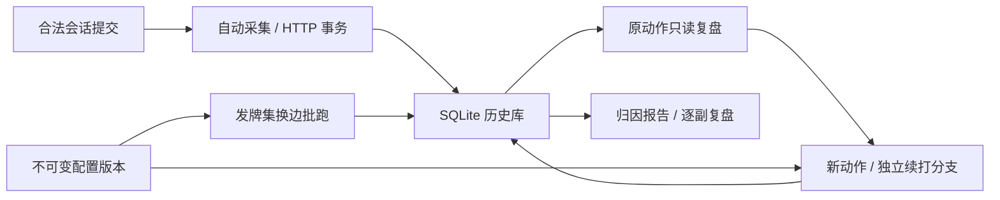

# 历史、复盘与配置的设计关系

> 文档类型：已实施设计的关系说明；复核日期：2026-10-14。P0–P3 已交付；字段、接口与验收分别由[存储](../features/history-storage.md)、[复盘](../features/history-replay.md)、[配置](../features/engine-profiles.md)、[模拟](../features/simulations.md)维护。返回[文档索引](../README.md)。

## 闭环与数据归属

普通对局与工作台的合法提交进入同一 SQLite 库。从历史读取保存的动作进行只读复盘；换动作或换后续配置时建立独立分支。正常发牌换边批跑与历史节点续打也保存到同一库，报告可以打开具体副牌复盘。

规则引擎仍是纯函数，不访问 SQL、AI 或网络。纯记录与会话契约在 `packages/protocol/src/`，浏览器历史编排在 `packages/history-core/src/`，Node 驱动与 Repository 在 `apps/server/src/history/`。`pnpm dev` 和独立 Node 服务共用实现；Tauri 无 Node 服务的原生 SQLite 适配后置。

## 关系与不变量

| 关系 | 设计目的 | 契约入口 |
| --- | --- | --- |
| 比赛 → 副牌 → 分支 → 动作父链 | 真实路径、反事实路径和重发/跨副过程均可追溯 | [历史存储](../features/history-storage.md) |
| 节点 / 分支起点 → 评估 | 建议不等于执行；采用评估关联真实提交，过期/取消单列 | [历史存储](../features/history-storage.md) |
| 四座分配 → 不可变 profile 版本 | 同类型不同参数独立；文件更新不改写旧局，显式局内切换另记版本 | [引擎配置](../features/engine-profiles.md) |
| 模拟运行 → 发牌组 → 双局 / 历史分支 | 持久进度、取消续跑、组级结果与逐副报告相互关联 | [模拟对战](../features/simulations.md) |

持久身份使用跨重启唯一 ID，不复用进程内 `game-1` 等序号。动作、分支游标与结算在同一事务保存，重试幂等；只有校验成功的命令进入动作路径。保存失败保留待保存包并暂停自动推进，重试成功后由玩家继续。

数据库路径不被内存诊断日志或有界回放窗口截断。恢复先检查协议、规则、摘要、动作父链和逐动作重放；版本化配置校验失败时不覆盖活动牌局。SQL schema、历史 JSON、配置文件和规则版本独立管理，定义以各自源码为准。

## 复盘与模拟隔离

原动作复盘不重新请求模型，不提交活动牌局。显示可切换座位或全牌，具体引擎仍使用阶段合法观察。历史库中的完整状态、暗牌和 seed 只用于存储、重放及规则校验，不直接传到 AI/RPC。

新分支保留原节点与后续；持久模拟使用独立会话与冻结的四座版本，切换节点/配置取消旧请求。模型凭据和完整服务端点从环境解析，不进入浏览器配置目录、历史或导出；旧环境引用可追溯不代表旧端点始终在线。

## 范围与证据

已交付的引擎创作范围是现有 Bridge、Algorithm、LLM 与 System One 的参数/模型配置，不包含任意脚本上传、插件市场或新推理框架。历史文件导入与原生离线历史仍未实现。

事务、幂等、失败重试、逐节点回放、原路径保留、同类型配置隔离、四座路由、取消/重启和信息边界均由对应功能回归验证；故障显式注入，数据库测试使用临时库。一次分支胜负或小批模拟只用于诊断，牌力结论和默认替换遵守[统一评测](../ai/evaluation-plan.md)。

任务状态与后续安排统一见[开发路线](../planning/development-roadmap.md)。
