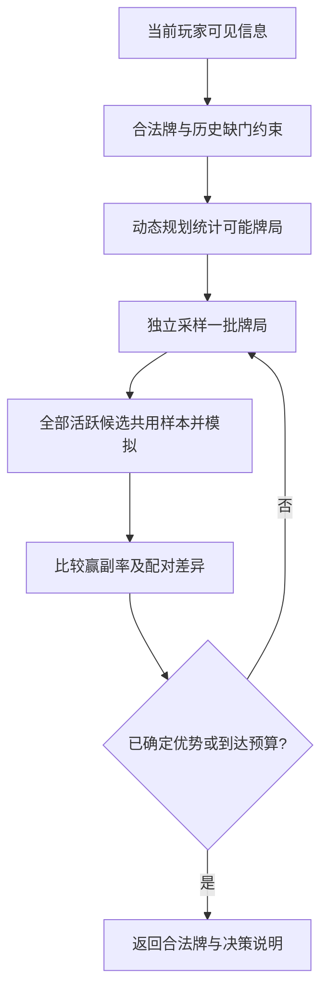

# 出牌 AI 优化算法设计

> 文档类型：算法设计；设计基线：2026-10-10。当前接入见 Algorithm 实现；原固定样本量建议不代替现行评测协议。返回[文档索引](../README.md)。

设计日期：2026-10-10。适用范围：项目当前默认规则的出牌阶段。

推荐采用**基于可见信息的配对蒙特卡洛搜索**：先生成符合公开记录的可能牌局，再让所有合法出牌在同一批牌局中接受比较，以己方最终赢副的比例作为主要评价。用动态规划提高采样效率，用有统计依据的淘汰减少无效计算，最后根据时间预算返回结果。

本文保留算法设计与验证标准。2026-10-10 首次实现，现为 Algorithm 引擎搜索内核；模块与 SOLID 原则见[实现说明](../ai/optimized-ai-implementation.md)；具体文件位于 `packages/ai-core/src/optimized/`。策略依据与反例见[最优出牌策略分析](../ai/optimal-play-strategy.md)。本文统一使用“轮”：四家各出一张牌算一轮。

## 1. 优化目标与边界

庄家叫 B 分，庄家已吃 D 分，闲家已吃 F 分。默认规则禁止把分牌扣底，因此：

```text
庄家获胜线：B
闲家获胜线：105 − B
终局奖励：己方赢副为 1，输副为 0
```

达到获胜线后可以提前结束模拟，剩余轮次不再影响本副结果。这里提前结束的是 AI 模拟，实际游戏流程仍由规则引擎控制。

设 I 为当前玩家可见信息，Ω(I) 为符合确定约束的可能牌局，b(ω | I) 为算法采用的牌局分布，π 为各座位的固定后续出牌策略。定义：

```text
Qπ(I, a) = Eω∼b, ξ[己方最终获胜的指示值 | 本手出 a，之后按 π 行动]
a* = argmaxa∈合法出牌 Qπ(I, a)
```

ξ 表示后续策略使用的独立随机性。固定后续策略，是为了让本次搜索中的候选具有稳定、可比较的评价标准。

这是对指定牌局分布和后续策略的近似最佳应对。对真实未知分布、任意敌人或整场游戏，都不能直接宣称严格最优。模型误差、模拟误差和对手策略差异应分别评估。

## 2. 整体流程



先把信息与目标处理正确，再提高搜索深度。原有 [search.ts](../../packages/ai-core/src/search.ts)、[sampling.ts](../../packages/ai-core/src/sampling.ts)、[evaluation.ts](../../packages/ai-core/src/evaluation.ts) 分别涉及候选截断、未知底牌信息和分差评价，正好对应这三个基础问题；这些模块保留用于对照，新搜索使用独立实现。

## 3. 输入必须是当前玩家的可见信息

算法接口接收 `PlayerObservation`，不直接接收完整 `GameState`。

```ts
interface PlayerObservation {
  seat: number;
  ownHand: readonly Card[];
  revealedHand?: { seat: number; cards: readonly Card[] };
  handCounts: readonly number[];
  declarer: number;
  bid: number;
  trump: Suit;
  leader: number;
  currentRound: readonly TrickCard[];
  completedRounds: readonly CompletedTrick[];
  declarerPoints: number;
  defenderPoints: number;
  kittySize: number;
  knownBuriedCards?: readonly Card[];
  ruleId: 'basic-v1';
}
```

类型示例复用项目已有的 `Card`、`Suit`、`TrickCard` 与 `CompletedTrick`，英文内部类型名可以保留。

`knownBuriedCards` 仅在该座位有权知道底牌时提供，通常为庄家本人；搭档不能共享庄家的私有信息。若界面以后公开了底牌，应显式记录公开事件。公共历史和手牌张数对所有座位可见。

叫到 100 分且庄家成功扣底后，庄家搭档的剩余手牌成为公共信息，通过 `revealedHand` 提供给全部四个座位（包括闲家与明牌玩家本人）。扣底前不提供；95 分及以下不提供。此规则不公开庄家手牌或底牌。

不传入仍隐藏的真实手牌、未知底牌身份和发牌 seed。搜索随机源与发牌随机源分离，复现测试另行传入独立的搜索 seed。实际对局中，随机数和打破平局的顺序不能依据隐藏状态。

## 4. 确定约束与牌局模型

未知牌池由完整 52 张牌减去自己的手牌、明牌玩家的剩余手牌、全部公开出牌和有权知道的底牌得到。自己也是明牌玩家时，只扣除一次自己的手牌。

逐轮扫描公开历史，记录每个座位的缺门：面对花色 s 的领出，没有跟 s，则其剩余手牌不再允许出现 s。当前轮已经发生的跟牌也要纳入。上一轮若已在完整历史中，不能重复扣除牌张。

每个可能牌局必须满足：

1. 三家剩余手牌张数与公开计数一致。
2. 同一张牌只能出现一次，全部未知牌均有去向。
3. 各家的手牌符合已确定的缺门约束。
4. 未知底牌恰好 4 张，且没有 A、10、5；已知底牌则固定，不再采样。
5. 100 分局的明牌手牌归属固定，不占未知手牌接收位置；校验明牌座位、张数、唯一性和缺门约束。

首版采用**在这些确定约束下均匀分配**的模型。它不会凭空猜测谁一定有 A，也不把“没有杀牌”误判成“没有主牌”。但这只是透明、可验证的基准分布，不是已经建模叫分、定主、扣底偏好和历史行动概率的真实后验。

后续可以加入行为模型，并用历史动作的似然调整分布；加入前需独立验证。不能一边搜索一边更换分布、继续混用旧统计。

## 5. 用动态规划直接采样，避免反复重发失败

当缺门信息较多时，先随机发牌、再检查合法性，可能大量失败。更好的方法是先计算每一步有多少种合法完成方式，再按这个数量选择去向。

### 5.1 状态与递推

将未知牌排成固定序列 `c[0..N-1]`，优先放约束较多的牌。三个其他座位和未知底牌是最多四个接收位置，其剩余容量记为向量 r。

`F(i, r)` 表示从第 i 张牌开始，能满足全部容量与约束的分配数量：

```text
F(N, 全零容量) = 1
F(N, 其他容量) = 0

F(i, r) = Σj F(i + 1, r − ej)

求和仅包含：位置 j 尚有容量，且允许接收 c[i] 的分支。
```

手牌位置按缺门限制花色；底牌位置按分值限制牌张。用记忆化缓存重复状态，数量使用 `bigint`，避免大整数失真。项目当前 TypeScript 目标为 ES2022，支持这个表示。

### 5.2 按完成数量选择去向

在状态 `(i, r)` 中，让牌进入位置 j 的概率为：

```text
P(j | i, r) = F(i + 1, r − ej) / F(i, r)
```

实现时生成 `[0, F(i, r))` 内均匀随机的大整数，按各分支的完成数量划分区间。可使用足够多的随机位与拒绝采样；不要先转成普通浮点整数后取模。

沿一条完整分配路径，概率相乘会抵消中间的 F，得到 `1 / F(0, 初始容量)`。因此，每一种符合这些约束的完整牌局具有相同概率。

每次独立抽取时重置容量，并使用新的随机数；DP 表可以共用，不必重新计算。

### 5.3 规模与失败处理

每个其他座位最多剩 12 张，未知底牌最多 4 张，因此容量组合至多：

```text
(12 + 1)³ × (4 + 1) = 10,985
```

虽然递推写了 i，但对固定牌序，i 由总剩余容量确定，所以不会再乘上 40 个独立层数。每个状态至多四个分支，每次采样至多分配 40 张牌。这个上限适用于当前规则和当前玩家手牌已经固定的情况。

若 `F = 0`，说明输入或历史约束不一致，应返回合法的快速策略作为兜底，并记录诊断。不能为了继续搜索而悄悄删除缺门约束。

## 6. 所有合法牌使用同一批样本

首轮不按分值、牌力或“搭档领先”删除合法牌。合法牌最多 12 张，先全部评估；启发式只影响评估顺序和超时兜底。

对第 w 个样本：

1. 独立抽取一个符合约束的牌局 ωw。
2. 为每个活跃候选 a，从同一个 ωw 的独立副本开始，先出 a。
3. 后续按固定策略 π 模拟，得到 `Yw(a) ∈ {0, 1}`。
4. 记录胜率以及候选间的配对差异。

比较 a、b 时使用：

```text
Δw(a, b) = Yw(a) − Yw(b)
估计胜率差 = 所有配对差异的平均值
```

两张牌接受相同的牌局难度，比较更公平。配对差异的方差为：

```text
Var(平均差异) = [Var(Ya) + Var(Yb) − 2 Cov(Ya, Yb)] / n
```

协方差为正时，共享样本会降低比较误差；这不是对所有候选都必然成立的定理，应在实验中测量。

若后续策略含随机性，使用与牌局采样独立的共享随机源。可以按“样本编号、行动座位、该座位的可见信息”生成随机键，使相同观察下的选择一致，同时避免不同分支的随机调用次数错位。

## 7. 后续模拟中的玩家也不能看暗牌

模拟器需要保存完整的采样牌局来执行规则。但每次请求玩家出牌时，只投影出该座位自己的 `PlayerObservation`：

```text
模拟器持有完整 ω
    → 投影当前行动座位可见的信息 Ip
    → πp(Ip) 返回合法牌
    → 模拟器执行该牌并更新公开历史
```

尤其不能把根节点玩家知道的手牌、底牌或根节点推断出的牌局分布，直接交给模拟中的搭档与敌人。

100 分明牌属于公共知识，模拟必须向每个行动者投影该手剩余牌，并在明牌玩家出牌后减少牌张。快速策略对明牌敌人直接检查合法压牌，遵守“有同门必须跟”的约束；暗牌敌人仍通过未知牌和缺门估计风险。残局的观察键包含明牌座位和规范排序后的剩余牌，因此后续分组和缓存不会丢失公开信息。只公开一手牌仍不是全信息对局，不切换为全员知道暗牌的 minimax。

后续策略以 [policy.ts](../../packages/ai-core/src/optimized/policy.ts) 的合法观察为输入，兼容 rollout 路径按假设世界推演；不能把“搭档领先就永不超车”作为通用约束。快速策略可以对以下因素排序：本轮得分、剩余敌人的压牌可能性、距获胜线的差距、分牌未来丢失风险、主牌控制与下一轮领出权。相关风险只能根据该座位可见信息估计。

首版后续策略保持固定，并在本次搜索中冻结参数。后续再通过独立训练样本调参；不能把“本轮最佳动作”的搜索递归无限调用到每一步。

把一个采样牌局当作全员已知，再对其做最优搜索，会允许同一观察下依据不同暗牌选择不同动作。这个问题称为策略融合，信息集搜索研究对其有明确讨论。[Cowling、Powley、Whitehouse，2012](https://eprints.whiterose.ac.uk/id/eprint/75048/1/CowlingPowleyWhitehouse2012.pdf)

## 8. 根据证据淘汰候选

先为所有合法牌做共同热身，再分批增加样本。建议固定检查点为：

```text
n = 16、32、64、128、256、512、1024
```

这是起始参数，需根据设备实测调整。只有在完成一个检查点后才更新排名、淘汰候选和生成带区间的最终报告。

### 8.1 可核查的淘汰条件

配对差异在 `[-1, 1]` 内。初始合法牌有 m 张，候选对数量为 `M = m(m−1)/2`，预设检查点数为 L，总模拟错误预算取 δ。对同一对牌的 n 个独立配对结果，使用半径：

```text
r(n) = sqrt[2 ln(2 M L / δ) / n]
差异区间 = [平均差异 − r(n), 平均差异 + r(n)]，与 [-1, 1] 取交集
```

当 a 相对 b 的区间上界小于 0 时，才淘汰 a。任一检查点均从所有候选对中选择比较对象，也由上述联合错误预算覆盖。

这是对有界独立随机变量使用 Hoeffding 界并对所有候选对和检查点取联合界得到的条件。[Hoeffding，1963](https://www.tandfonline.com/doi/abs/10.1080/01621459.1963.10500830)

在所用模型正确冻结、样本独立、只在预定检查点检验的条件下，以至少 `1−δ` 的概率，所有用于淘汰的差异区间都包含其模型内真实均值，真正最好的候选不会被错误淘汰。

这不是“推荐牌真实胜率至少 95%”。它只控制模型内的抽样错误，而且这个界较保守：少量样本通常无法证明 51% 比 49% 更好。首版应接受“预算内无法分清”，不应为了多淘汰而滥用反复查看的普通置信区间。

### 8.2 截止时间与结果选择

- 某候选相对全部其他活跃候选的区间下界均大于 0，可以提前返回，并标记“模型内已有比较证据”。
- 到达时间或样本预算时，返回最后完整检查点中经验胜率最高的候选；未能证明差异时标记不确定。
- 保守模式可始终保留快速策略推荐牌，只有新牌相对它的区间下界大于 0 才切换。
- 热身尚未完整完成就超时，返回快速策略推荐的合法牌，不生成未完成搜索的胜率结论。

被淘汰的牌停止增加样本；仍活跃的牌继续共用每一个后续样本。不要拿不同样本数下的原始获胜次数直接比较。

## 9. 残局进一步优化

少量剩余牌允许加强搜索，但“当前玩家推断出全部牌”不代表搭档和敌人也知道全部牌。

### 9.1 首版保持信息受限的完整模拟

默认仍使用观察策略走到胜负确定，确保估计目标一致。不因只剩三轮就自动把暗牌翻开做 minimax。

### 9.2 小规模可能牌局的精确应对

当可能牌局数和剩余动作数足够小，可枚举全部可能牌局，建立当前玩家的信念状态，并对固定搭档、敌人策略做精确期望搜索：

```text
轮到当前玩家：对全部合法牌取最大期望值。
轮到其他玩家：按其各自观察下的固定策略分布，枚举其出牌。
观察到出牌后：按该行动的概率更新可能牌局权重。
胜负确定：返回 0 或 1。
```

当前玩家未来的选择必须把观察完全相同的分支合并。其他玩家分别按自己的观察行动，不能把搭档当作可共享私有手牌的中央控制器。

完整枚举完成时，结果是指定初始分布和固定其他策略下，当前玩家的最优应对。若搜索被截止时间打断，则只能报告近似结果，并回退到已完成的模拟统计。

建议初始门槛为“每家至多 3 张、完整可能牌局数至多 256”，再增加节点数和时间上限。门槛是待验证的工程参数，不是完成搜索的保证。

只有全部剩余手牌已成为公共知识，才把普通按队伍取最大或最小值的全信息搜索作为真实对局的精确模块。全信息搜索也可独立用于回归测试，但测试的最优值不直接充当暗牌实战胜率。

信念状态结合模拟规划的思路可参考 POMCP；其原始问题设定是 POMDP，本设计中的固定其他玩家策略为环境模型的一部分，不能直接套用为四人搭档博弈的均衡保证。[Silver、Veness，2010](https://papers.nips.cc/paper_files/paper/2010/file/edfbe1afcf9246bb0d40eb4d8027d90f-Paper.pdf)

## 10. 主算法伪代码

```text
chooseCard(observation, budget, frozenPolicy, searchRandom):
    legal = legalCards(observation)
    if legal 只有一张:
        return legal[0]

    fallback = frozenPolicy.choose(observation)
    if 已锁定本副胜负:
        return fallback

    constraints = inferConstraints(observation)
    sampler = buildCompletionCountDP(constraints)
    if sampler 无合法牌局:
        return fallback，并记录诊断

    active = 所有 legal
    stats = 空的候选及配对统计
    committed = 空

    for target in 预设检查点:
        pending = stats 的临时副本

        while pending 的共同样本数 < target:
            omega = sampler.drawIndependent(searchRandom)
            sharedNoise = drawIndependentPolicyNoise()

            for a in active:
                simulation = 独立复制 omega，并执行 a
                y[a] = simulateUntilOutcomeLocked(
                    simulation,
                    每一步只向策略投影行动座位的观察,
                    frozenPolicy,
                    sharedNoise
                )

            若整行所有 active 均完成:
                pending.addPairedRow(y)

            若超时:
                return 根据 committed 返回；若无 committed，返回 fallback

        stats = pending
        committed = 保存本检查点结果
        active = 根据联合差异界淘汰确定较差的候选

        if 有候选被证明优于全部其他候选:
            return 该候选，以及模型内比较证据

    return 最后完整检查点的推荐牌与不确定性说明
```

时间检查要进入 DP 构建和模拟内部。一个检查点没有完整完成时，临时结果不混入已提交统计，避免不同候选因为计算耗时不同而受到选择偏差。

## 11. 性能与项目接入

若 m 张合法牌、K 个样本、每次最多 T 次出牌，模拟复杂度约为 `O(mKT × 策略成本)`；当前规则中 `m ≤ 12`、`T ≤ 48`。淘汰候选、获胜线提前停止和残局缓存可以降低实际计算量。

| 已实现模块 | 职责 |
| --- | --- |
| `packages/game-view/src/observation.ts` | 投影玩家观察、从观察计算合法牌、构造信息键 |
| `packages/ai-core/src/optimized/belief.ts` | 历史缺门约束、DP 完成数量与独立采样 |
| `packages/ai-core/src/optimized/simulator.ts` | 轻量模拟状态、按规则执行动作、获胜线提前停止 |
| `packages/ai-core/src/optimized/policy.ts` | 仅依赖观察的固定快速策略 |
| `packages/ai-core/src/optimized/pairedSearch.ts` | 共同样本、配对统计、检查点与候选淘汰 |
| `packages/ai-core/src/optimized/endgame.ts` | 小规模信念残局搜索 |
| `packages/ai-core/src/optimized/worker.ts`、`workerClient.ts` | 异步搜索、截止时间、取消和结果消息 |

建议在 Web Worker 中搜索，避免阻塞 React。Worker 只收到序列化的观察和明确规则标识，不收到完整 `GameState`；其中的计分函数也不适合直接序列化。

原有 `PlayerAgent.nextAction` 是同步接口。实现中新增独立的 `AsyncPlayerAgent.nextActionAsync`，其他阶段继续使用原接口。[useGame.ts](../../apps/web/src/hooks/useGame.ts) 使用取消信号及发起搜索时的状态对象校验结果，重开、换副、状态或速度变化时取消旧请求；Worker 适配器另外检查请求编号及返回牌的合法性。请求编号只是控制标识，不能编码暗牌。

首轮可设桌面 250 ms、移动端 120 ms 为目标搜索预算，样本硬上限 1024；这些是待基准测试的目标值，不是已经达到的延迟承诺。策略版本、分布版本和预算应随评估结果一并记录。

模拟器不必复制完整日志和 React 状态，但它必须与规则引擎对相同动作得到相同的赢家、分数和剩余牌。缓存只能跨相同规则与策略版本复用；策略相关缓存键不能包含不可见牌。

## 12. 验证计划与上线标准

### 12.1 正确性

设计阶段已用一个六张牌的缩小模型校验采样递推：牌为 ♥A、♥2、♦10、♦3、♠4、♣6，三个手牌位置容量分别为 2、1、1，底牌容量为 2；第一个手牌位置缺红桃，第二个缺黑桃，底牌禁止分牌。直接穷举与 DP 均得到 22 个合法分配，每条完整采样路径的概率严格为 `1/22`。正式实现已将该模型纳入回归测试，并用固定独立随机源进行 4400 次抽样检查；具体覆盖以 tests/optimized.test.ts 为准。

- 用小牌组穷举全部合法分配，对比 DP 的完成数量，验证采样概率与约束。
- 隐藏手牌和未知底牌改变、玩家观察不变时，固定搜索随机源应产生相同决策；所有模拟策略也必须满足这一性质。
- 随机合法动作序列下，轻量模拟器和规则引擎逐步结果一致。
- [策略文档](../ai/optimal-play-strategy.md) 中的两轮超车残局作为关键回归用例，不能在搜索前排除 ♥A。
- 覆盖第四手安全喂分、第三手保护搭档、用大主跨过获胜线、分数已锁定、唯一合法牌、零合法分配和中途超时。
- 精确残局模块完成搜索时，和小规模独立穷举结果一致。

### 12.2 胜率和耗时

复用 [experiments/harness.ts](../../experiments/harness.ts) 的对局编排与配对比较思路，增加新策略对固定基线的实际对打。仅让四家同时切换策略、比较庄家成局率，不能证明哪套策略对打更强。

固定叫分、定主、扣底，使用相同发牌样本，交换双方并轮换座位。训练、调参和最终评估使用互不重叠的种子集合；同一发牌的多种轮换按一个样本组统计不确定性，避免把相关对局当成独立样本。

分阶段消融：公平采样 → 二元胜负评价 → 全合法候选 → 共同样本 → 改进后续策略 → 自适应预算 → 残局模块。每一步都记录赢副率、配对胜率差、P50/P95 耗时、超时比例和样本数。

正常模式和相同时间预算下的旧搜索都作为基线；旧策略能访问未知底牌的结果应注明信息条件，最好另设信息公平的旧策略对照。不能把更多计算量带来的变化全部归因于算法。

样本量按预声明的目标差异、区间宽度与预算确定，不以固定发牌组数代替统计判断。正式切换默认 AI 前，应在未用于调参的数据上确认胜率差为正，且不超过设备延迟目标。

## 13. 扩展边界

观察、采样、配对搜索、Worker、检查点和小残局已经有实现。新改动应选择单一假设，通过正确性和信息隔离回归后，在固定条件下做消融与独立确认，避免重新维护一份旧的实施步骤。

采样对确定约束的均匀性、模型内误差界与实际结算一致性可以分别验证；这些性质不自动证明完整暗牌博弈的均衡最优或实战牌力优势。
