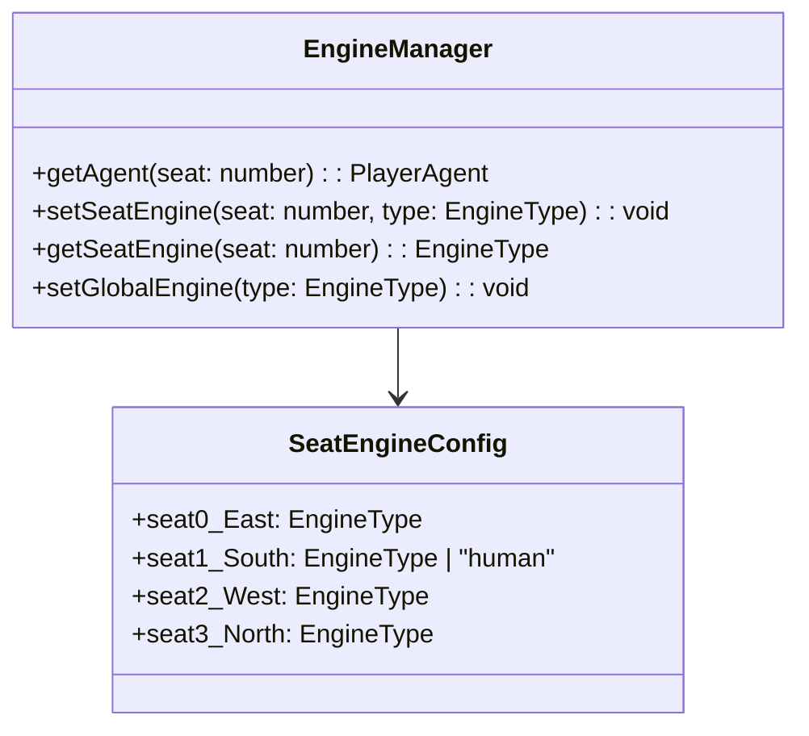

# 保山幺子分 · 开发者上帝调试模式 (God Mode 2.0) 架构规划与重构方案

> **文档版本**：v2.0.0  
> **制定日期**：2026-10-11  
> **适用范围**：保山幺子分客户端 (`src/`)、服务端决策代理 (`server/`)、AI 算法与强化学习调优工作流 (`experiments/` & `src/ai/`)

---

## 1. 现状痛点诊断与根因分析

当前代码库中已具备基础的“上帝模式透视”与“正方形上帝调试牌桌（`SquareTable` + `DebugSidePanel`）”，但在**真实开发调试 (Debug)** 和 **AI 算法调优 (Algorithm Tuning)** 场景下，存在以下五大核心维度的硬伤与断层：

### 1.1 概念混淆与状态模型割裂
- **三种“上帝模式”定义混淆**：
  1. `godModeEnabled` / `devPeekSeats`：仅代表在普通牌桌上允许点击对手头像透视手牌；
  2. `isDebugMode`：切换为独立的 1:1 正方形牌桌与侧边控制台；
  3. `isGodMode`：在 `useGame.ts` 中直接绑定为 `isAllPeeked`（即四家是否全部翻开明牌）。
  三个概念在状态管理、配置持久化（`localStorage`）和传递层层传导中混杂，导致开发心智负担重。
- **信息对称性（Oracle vs Partial Observation）未解耦**：
  - 目前的“透视”仅是人类视角的 UI 明牌渲染，底层的 `PlayerObservation` 仍然对 AI 严格遮蔽暗牌。
  - **缺失真·全知求解器 (Oracle Mode)**：在算法调优和基准对比（Benchmark）时，调优者迫切需要一种“全知双明手求解（Perfect Information Oracle）”作为 **Ground Truth（理论天花板）**，用以评估有限信息引擎（PIMC / LLM / Laya / RL）决策的折损率（Regret Value）。当前系统缺乏这一模式。

### 1.2 非出牌阶段控制权全面丧失（无法全阶段任意座位干预）
- **叫分 (Bidding) 阶段无法干预**：当轮到电脑座位（东/北/西）叫分时，中控台仅显示“等待 XX 叫分…”，开发者无法点击任意座位的叫分按钮强行介入（如测试“西家激进叫 80 时各家防守反应”）。
- **定主 (Trump) 阶段无法干预**：非人类庄家定主时，开发者无法强行更改主牌花色（如测试“定方块 vs 定黑桃对后续残局防守的影响”）。
- **扣底 (Burying) 阶段无法干预**：电脑坐庄时，开发者无法手动选择特定 4 张底牌，只能被动等待 AI 默认算法扣底。
- **出牌阶段缺乏轮次自由度**：虽然支持点击当前轮次 AI 的合法手牌代打，但无法临时指定“由谁领出”，无法在任意时刻测试非当前行动方的候选出牌反应。

### 1.3 残局构造与调试复现瓶颈（只出不进的单向快照）
- **无法导入快照**：控制台提供“📋 导出 GameState 快照”，但**完全没有“导入/粘贴快照”的入口**。当线上或测试发现坏局 (Badcase)，无法复制 JSON 一键重现案发现场。
- **缺乏可视化残局/手牌编辑器 (Scenario Editor)**：为了复现某个特定花色断门杀牌的残局，开发者只能反复随机尝试种子（`seed`），无法自由拖拽调配四家手牌、底牌与比分。
- **撤销 (Undo) 与时序脱节**：
  - 在非单步模式（自动连打）下点击撤销，`useEffect` 立即感知并光速重走，导致撤销操作瞬间失效；
  - 撤销后，`thinkingService` 与 `decisionLogger` 的记录未同步回滚，导致时间线与实际牌局错位。
- **单步预推演竞态 (Race Condition)**：`isStepMode` 开启时，AI 会在 `useEffect` 中自动异步预算 `pendingAiAction`。若此时开发者在面板切换了引擎（如从 Bridge 改选 LLM），`pendingAiAction` 依然是旧引擎结果，点击 Next 执行的依然是旧动作。

### 1.4 算法调优与多引擎同台竞技能力缺失
- **无法为四个座位独立配置不同引擎**：
  - 当前引擎切换是全局统一的（所有 AI 座位共用同一种引擎）；
  - 保山幺子分是 **2v2 搭档博弈**，算法调优最核心的诉求是：**南北（引擎 A）VS 东西（引擎 B）**（如 LLM+DDS 对抗 双DDS，或自训 RL 对抗 桥牌专家规则）；
  - 无法配置异构对战，无法进行自动化离线天梯/联赛评测。
- **同节点缺乏横向多引擎并行比选 (Side-by-Side Evaluator)**：
  - 在出牌分岔路口，开发者无法一键同时请求 Bridge、LLM、Laya 三个引擎，直观横向比对它们的选牌、预估胜率、推演理由和耗时。
- **全阶段日志断流**：
  - `decisionLogger` 仅在出牌阶段记录。叫分、定主、扣底阶段（`chooseAction`）完全没有落盘到日志和时间线中，导致无法追溯叫分和埋底的决策依据。
- **底层搜索指标黑盒**：
  - 桥牌 DDS (双明手极小化极大搜索) 的搜索树深度、置换表命中率、Alpha-Beta 剪枝次数未暴露；
  - LLM 缺乏现场修改 Prompt 模板并即时重测的能力；
  - Laya 缺乏动作概率分布（Softmax Logits）可视化。

### 1.5 界面人机工学与开发体验
- **空间挤压与牌面遮挡**：在 1080P 或笔记本屏幕下，右侧控制台固定宽度会压缩中央正方形牌桌，导致东西两家手牌与出牌十字槽互相遮挡。
- **缺乏键盘快捷键闭环**：仅支持 Space 键推进，缺乏单步撤销 (`Z`)、重开 (`R`)、AI提示 (`H`)、引擎切换 (`1-4`)、任意座位出牌等极客热键。

---

## 2. 上帝模式 2.0 (God Mode Workbench) 架构愿景

将上帝模式从单纯的“偷看暗牌挂”彻底升级为面向算法研究员与核心开发者的 **专业级博弈沙盘与调试控制台 (AI Game Workbench)**：

```mermaid
flowchart TD
    subgraph Core[上帝工作台核心引擎 (God Mode Engine)]
        OM[全知状态机 Oracle State Machine]
        SE[残局沙盘与快照系统 Scenario Sandbox]
        IM[全阶段全座位干预器 Omnipotent Interceptor]
        CO[多引擎横向比对器 Multi-Engine Comparator]
        RO[四座异构引擎路由 Seat-Engine Router]
    end

    subgraph UI[前端呈现与交互层]
        ST[1:1 对称正方形沙盘牌桌 SquareTable 2.0]
        DP[全功能调试与指标侧边栏 DebugSidePanel 2.0]
        ME[可视化残局编辑器 Modal HandEditor]
        CL[横向多模型比选抽屉 Side-by-Side Drawer]
    end

    subgraph Engines[决策引擎矩阵]
        B[Bridge DDS 桥牌深度思考]
        L[Laya 非自回归概率策略]
        M[LLM 大模型深度推理]
        A[Algorithm 传统采样搜索]
        R[RL 强化学习策略 (研发中)]
    end

    IM --> OM
    SE --> OM
    RO --> Engines
    CO --> Engines
    OM --> ST
    OM --> DP
    SE --> ME
    CO --> CL
```

### 核心定位三要素
1. **全知全能 (Omnipotent Control)**：任意阶段、任意座位，开发者均可随时接管、改判、指定动作或调整状态；
2. **确定可复现 (Deterministic Sandbox)**：支持紧凑 FEN 码与完整 JSON 快照双向导入/导出，支持可视化残局自由摆盘；
3. **算法调优透视 (Algorithm Observability)**：支持四座异构模型对战、单步横向多模型打分对比、全阶段决策链回溯与底层算法指标白盒化。

---

## 3. 功能特性详细规划 (Functional Specification)

### 3.1 模块一：全阶段全座位干预器 (Omnipotent Interceptor)

在上帝模式开启时，接管所有规则轮次限制，向开发者开放全局特权：

| 阶段 | 传统玩家视图限制 | 上帝模式 2.0 特权动作 |
|---|---|---|
| **发牌前/重开** | 随机发牌 / 固定种子 | 支持自由指定种子、导入 FEN/JSON 局面、或进入“摆盘器”自定义四家手牌 |
| **叫分 (Bidding)** | 轮到当前玩家才能叫/不叫 | **全座位自由代叫**：可点击任意座位头上的叫分控制器，强制为该玩家执行指定分值叫分或放弃 |
| **定主 (Trump)** | 只有人类是庄家时能选花色 | **全座位自由定主**：庄家定主时展示四门花色统计，开发者可直接为任意庄家指定任意主牌花色 |
| **扣底 (Burying)** | 只有人类是庄家时能摸底扣底 | **全座位自由扣底**：可直接查看底牌并为任意庄家挑选/修改 4 张扣底牌，提供“合法性校验与分牌预警” |
| **出牌 (Playing)** | 仅能出自己手牌且受限于轮次 | 1. **点击任意座位手牌代出**（当前轮次直接出牌，非当前轮次可“强制切换领出权”）；<br>2. **强制出牌模式 (Force Play)**：允许绕过同门必跟规则用于测试规则防御；<br>3. **动作推荐指示**：当前轮次高亮当前配置引擎推荐打出的牌 |

### 3.2 模块二：残局沙盘与快照编辑器 (Scenario Sandbox & FEN)

为了彻底解决“线上 Badcase 无法复现、特定战术残局难构造”的问题，建立保山幺子分专用的 **紧凑残局表示协议 (Yaozifen FEN / YZF-FEN)** 与 **可视化摆盘器**。

#### 1. YZF-FEN 规范设计
采用类似桥牌 PBN 与国际象棋 FEN 的紧凑单行字符串描述局势：
```text
YZF-FEN: <Phase>:<Trump>:<Declarer>:<Bid>:<EastHand>/<SouthHand>/<WestHand>/<NorthHand>:<Kitty>:<CurrentTrick>:<Points>
示例:
P:H:1:75:AS,KD,10C,5H/AH,KS,QD,10S/QS,JH,8D,5S/AC,KC,10D,5D:4H,4D,3C,2S:1:AS,2:KS:D30,F15
```
- **导入/导出**：
  - 支持一键导出 YZF-FEN 紧凑码与全量 JSON 快照；
  - 侧边栏提供“📥 粘贴导入局势”输入框，粘贴后 10 毫秒内重构游戏状态树并进入单步调试模式。
- **可视化摆盘器 (Visual Board Editor Modal)**：
  - 点击“🛠️ 局势编辑器”，弹出全屏 54 张牌点选面板；
  - 支持将牌自由分配给东、南、西、北、底牌或弃牌堆；
  - 自动校验保山幺子分基础约束：总分 100 分守恒、四家牌数平衡（出牌中途各家牌数相等）、底牌为 4 张；
  - 保存后立即生成新局势并开启单步推演。

### 3.3 模块三：座位解耦异构引擎矩阵与竞技场 (Seat-Decoupled Engine Arena)

打破“所有 AI 共用同一种引擎”的限制，实现每个座位的独立决策指派：



1. **四座独立配置面板**：
   - 东家 (Seat 0)：可选 Bridge / Algorithm / Laya / LLM / RL；
   - 南家 (Seat 1)：可选 人类操作 (Human) / Bridge / Algorithm / Laya / LLM / RL（允许全自动 4 AI 互博观战模式）；
   - 西家 (Seat 2)：可选 Bridge / Algorithm / Laya / LLM / RL；
   - 北家 (Seat 3)：可选 Bridge / Algorithm / Laya / LLM / RL；
2. **一键预设阵营对抗 (Presets)**：
   - `[经典阵营]`：南北（人类 + Bridge 搭档）VS 东西（双 Algorithm）；
   - `[AI 竞技场]`：南北（双 Bridge）VS 东西（双 LLM / 双 Laya）；
   - `[搭档协同验证]`：测试单侧模型驱动（如东家 LLM）与算法搭档（西家 Bridge）配合效果；
3. **全自动评测批跑模式 (Headless Benchmark Mode)**：
   - 沙盒工具中新增“批量对战测试 (Run 100 Hands)”；
   - 给定种子区间（如 1000~1100），后台静默并行快速推演；
   - 自动统计并输出：成局率 (Make Rate)、双方平均吃分、各引擎平均决策延迟、超时/降级率。

### 3.4 模块四：同节点多引擎横向推演比对器 (Side-by-Side Comparator)

在算法调优中，遇到关键出牌节点，工程师最需要对比不同流派的判断差异。

- **一键“⚡ 多引擎并行比选”**：
  在控制台“候选比选”或“思维推演”标签下，提供一个【全引擎同屏比对】按钮。
- **比对结果卡片同屏展开**：
  在当前局势冻结状态下，向所有已配置引擎并行发起候选评估，并排输出对比卡片：

| 评估维度 | 桥牌 DDS (Bridge) | 大语言模型 (LLM) | 深度策略网络 (Laya) | 传统采样搜索 (Algorithm) |
|---|---|---|---|---|
| **首选打法** | ♦2（保牌垫最小） | ♦2（搭档必赢） | ♦2 ($P=0.82$) | ♦K（误判超车） |
| **战术理由** | DDS 极小化极大推演：搭档 ♦A 稳赢，保留 ♦K 防守 | 提示词战术推演：搭档已赢，无须消耗高点大牌 | 隐层状态注意力高度聚焦于搭档出牌槽位 | 蒙特卡洛随机采样方差波动 |
| **预期收益** | 终局净胜分 $+25$ 分 | 置信度 $92\%$ | 策略网络输出分布 Top-1 | 预估胜率 $68\%$ |
| **响应耗时** | $180\text{ ms}$ | $1850\text{ ms}$ | $190\text{ ms}$ | $240\text{ ms}$ |
| **代打操作** | [采用此走法] | [采用此走法] | [采用此走法] | [采用此走法] |

开发者可一键点击任意卡片的【采用此走法】，执行对应引擎的推荐牌并向下推进。

### 3.5 模块五：全生命周期白盒化诊断与算法指标 (Observability & Metrics)

#### 1. 补齐全阶段决策链记录
- 改造 `engineAdapter.ts`：在 `chooseAction`（叫分、定主、扣底）中，统一调用 `this.logger.recordAction(...)`；
- 记录结构扩展：
  - `phase: 'bidding' | 'trump' | 'bury' | 'playing'`
  - 叫分阶段：记录四家手牌牌力估值（Hand HCP / 控制张统计）、叫分候选列表与最终决策；
  - 定主阶段：记录各门花色长套张数、分值期望与选主理由；
  - 扣底阶段：记录候选 4 张牌扣除方案、扣除非分牌安全性评估与保牌期望。

#### 2. 底层算法指标暴露 (White-box Diagnostic Metrics)
- **Bridge DDS 引擎**：
  - 展开置换表命中次数 (`ttHits`)、Alpha-Beta 剪枝分支数 (`prunedBranches`)、搜索展开深度 (`searchDepth`)；
- **LLM 引擎**：
  - 现场查看完整 System / User Prompt；
  - **Prompt 在线调试器 (Prompt Playground Drawer)**：允许在界面临时修改提示词模板，点击【重新推理】，即时查看模型回答并比对选牌差异；
- **Laya / RL 引擎**：
  - 展示所有合法候选牌的 Softmax 概率分布直方图（Logits Bar Chart），高亮 Top-1 与 Top-2 的边际熵（Entropy）。

### 3.6 模块六：人机工学与极客快捷键系统 (Ergonomic UX)

#### 1. 响应式布局自适应 (Responsive Workbench)
- **自适应分栏与可拖拽宽度**：
  - 侧边栏宽度支持自由拖拽调节（320px ~ 600px），或一键“收起/展开”；
  - 在屏幕宽度不足 1200px 时，自动切换为“牌桌置顶 + 调试控制台底置/浮动抽屉”模式，杜绝牌桌压缩变形。
- **四方明手视觉增强**：
  - 牌面正反面提供三档调节：
    1. `各玩家物理朝向`（真实牌桌几何）；
    2. `全部正向朝向我`（双排横排平铺，最适观察）；
    3. `紧凑花色统计矩阵`（按黑桃/红心/梅花/方块分列列出，方便桥牌高手盘牌）。

#### 2. 全键盘极客操作映射表 (Keyboard Control Map)

| 快捷键 | 功能说明 | 适用场景 |
|---|---|---|
| <kbd>Space</kbd> | 单步推进下一步 (Next Step) | 单步调试 AI 思考 |
| <kbd>Enter</kbd> | 执行选中的出牌 / 确认当前操作 | 手动出牌 / 代打确认 |
| <kbd>Z</kbd> / <kbd>Cmd+Z</kbd> | 撤销上一步 (Undo) | 回滚探索不同出牌分支 |
| <kbd>Shift+Z</kbd> | 重做下一步 (Redo) | 沿历史推演分支前进 |
| <kbd>H</kbd> | 触发当前座位 AI 提示 (Hint) | 查看当前最佳打法 |
| <kbd>1</kbd> ~ <kbd>4</kbd> | 快速切换当前主引擎 (Bridge / Alg / LLM / Laya) | 快速换引擎测试 |
| <kbd>R</kbd> | 重开本局 (Restart with same seed) | 重跑相同牌局 |
| <kbd>Tab</kbd> | 循环切换调试面板选项卡 (Think / Candidates / Ledger / History / Sandbox) | 高效查看诊断 |
| <kbd>Esc</kbd> | 关闭所有弹窗与抽屉 | 快速清理界面 |

---

## 4. 技术架构重构方案与数据流设计

### 4.1 核心状态流重构：解耦 GodMode 与 DebugMode

```typescript
// src/ai/engines/engineTypes.ts 与 src/hooks/useGame.ts

export interface GodModeState {
  /** 是否开启开发者上帝透视（允许看对手暗牌） */
  peekEnabled: boolean;
  /** 当前被翻开明手的座位集合 */
  peekedSeats: Set<number>;
  /** 是否开启全知求解器模式（AI 引擎算法亦使用全明手完全信息求解，用于理论上限对比） */
  oracleSolverEnabled: boolean;
  /** 四个座位的独立引擎绑定（解耦全局单一引擎） */
  seatEngines: Record<number, EngineType>;
}

export interface WorkbenchDebugState {
  /** 是否进入 1:1 正方形全功能调试工作台视图 */
  active: boolean;
  /** 单步执行模式（true 为单步等待 Space，false 为自动连打） */
  stepMode: boolean;
  /** 允许任意座位出牌与强制定主/扣底/叫分 */
  omnipotentIntervention: boolean;
}
```

### 4.2 历史推演时光机与分支探索 (Time-travel & Branching Tree)

现在的 `historyStack: GameState[]` 仅能支持单线撤销，若撤销后走新分支，旧分支数据丢失。
在 God Mode 2.0 中，将历史记录升级为 **分支探索树 (Decision Branch Tree)**：

```typescript
export interface HistoryNode {
  id: string;
  parentId: string | null;
  state: GameState;
  actionTaken: AiAction | null;
  decisionRecordId?: string;
  children: string[]; // 支持多个探索分支
}
```
- 开发者撤销到第 4 轮后，换另一张牌打出，系统会自动生成新分支（Branch B）；
- 在“历史追溯”标签中，展示树状/分支版本轴，开发者可在不同出牌分支间自由切换对比终局分数！

### 4.3 引擎适配器升级：全阶段全链路捕获

修改 `EnginePlayerAgent`，使全阶段的生命周期统一穿透并落盘：

```typescript
// src/ai/engines/engineAdapter.ts
async nextActionAsync(state: GameState, signal?: AbortSignal): Promise<AiAction | null> {
  const seat = currentSeat(state);
  if (seat < 0) return null;

  const currentEngine = this.getSeatEngine(seat); // 根据座位路由引擎

  if (state.phase !== 'playing') {
    // 叫分 / 定主 / 扣底阶段
    const res = await currentEngine.chooseAction(state, seat, signal);
    // 统一落盘到 decisionLogger，记录阶段特有诊断与思考
    this.logger.recordAction({
      phase: state.phase,
      seat,
      engineType: currentEngine.type,
      decision: res,
      stateSnapshot: state,
    });
    return res.action;
  }

  // 出牌阶段（原有链路保持并注入 DDS/LLM 详细指标）
  // ...
}
```

---

## 5. 分阶段实施路线图 (Implementation Roadmap)

| 阶段 | 周期 | 核心交付物 | 达成目标 |
|---|---|---|---|
| **Phase 1: 核心体验与全阶段干预修复 (P0)** | 1-2 天 | 1. 拆分解耦 `godModeEnabled`、`isGodMode` 与 `isDebugMode`；<br>2. 修复 `ControlPanel` 与 `SquareTable`：支持叫分、定主、扣底阶段任意座位手动接管；<br>3. 修复 `isStepMode` 下切换引擎时的 `pendingAiAction` 缓存竞态；<br>4. 统一快捷键映射处理（Space/Enter/Z/H/R/1-4）。 | 消除现有死锁与控制缺陷，实现叫分、定主、扣底、出牌全生命周期 100% 任意干预。 |
| **Phase 2: 残局沙盘与快照导入导出 (P0)** | 2-3 天 | 1. 设计并实现 YZF-FEN 紧凑格式解析与序列化器；<br>2. 沙盒工具新增“📥 粘贴导入快照 / FEN 码”；<br>3. 研制“可视化残局摆盘编辑器 (Hand Editor Modal)”；<br>4. 撤销回退与 `decisionLogger` 时间线联动回滚。 | 彻底打通 Badcase 复现闭环，算法调优可精准构造残局测试案例。 |
| **Phase 3: 算法调优多模型竞技场 (P1)** | 3-4 天 | 1. 实现四座位独立引擎配置矩阵（支持 4 家异构引擎对战）；<br>2. 研发【同节点多模型横向推演比对器 (Side-by-Side Comparator)】；<br>3. 暴露 DDS 剪枝与置换表命中率、LLM Prompt 在线调试与 Laya Softmax 柱状图；<br>4. 全生命周期（叫分/定主/扣底）日志落盘与追溯展开。 | 成为保山幺子分顶级 AI 开发调试与自训强化学习 (RL) 的核心生产力基座。 |

---

## 6. 验收标准与质量保证 (Acceptance Criteria)

1. **控制完整性**：
   - 在叫分、定主、扣底阶段，任意电脑座位的操作均可由开发者手动点击按钮接管并推进，且状态合法无报错；
   - 在出牌阶段，可点击任意座位的手牌进行代打，并具备防误触保护。
2. **快照确定性**：
   - 任意合法局势导出为 YZF-FEN 或 JSON 快照后，再次粘贴导入，必须 100% 还原手牌、底牌、叫分、主牌与历史出牌堆；
   - 摆盘器构造的非法牌面（总分 $\neq 100$、牌数不对）能被实时拦截并友好提示。
3. **算法调优透明度**：
   - 叫分、定主、扣底、出牌均能在“历史追溯”中查看到独立 JSON、思考链与耗时；
   - 同节点多模型比对器能在 2 秒内聚合展示 Bridge / LLM / Laya 的横向推演结果。
4. **自动化测试覆盖**：
   - 编写针对全阶段干预、FEN 序列化/反序列化、四座独立引擎分发的全套单元测试，确保测试套件通过率保持 100%。
