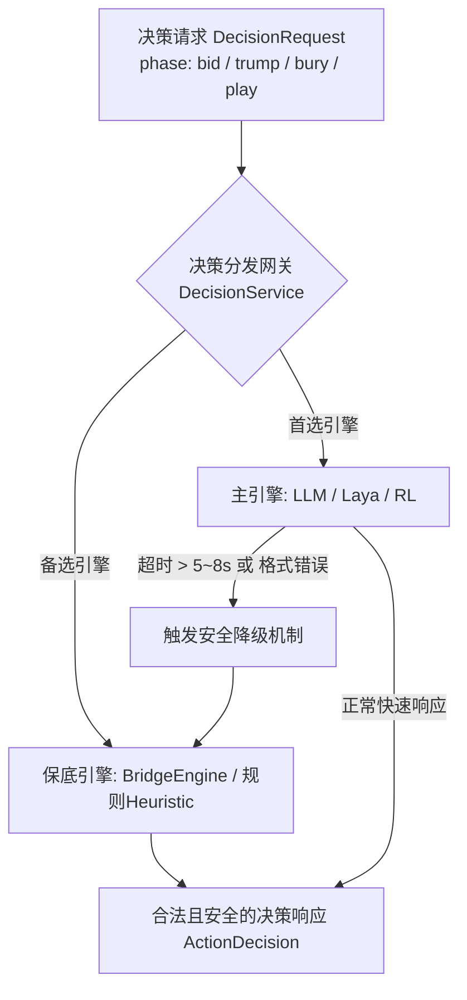

# 保山幺子分 · LLM 全生命周期决策架构与 Prompt 演进方案

> 历史设计记录：本文保留早期问题分析与方案，部分“当前缺陷”和延迟描述已过时。2026-10-12的实际四阶段实现、Prompt 2.0变更与验证见[提示词优化记录](llm-prompt-optimization.md)。


> **文档定位**：本方案针对保山幺子分中 **叫分、定主/选主、扣底/扣牌、出牌** 4 个核心决策动作，反思当前 LLM 实现的缺陷，提出一套**“完整规则 + 专家经验 System Prompt”**与**“贯穿全局的历史轨迹 Message List”**的统一决策架构，并规范全阶段多引擎接入标准。

---

## 一、 现状反思与痛点剖析

对照高水平实战对弈标准，现有实现（[`src/ai/engines/llmEngine.ts`](file:///Users/zxr/coding/A%20play/baoshan-yaozifen/src/ai/engines/llmEngine.ts)）存在以下三项核心缺陷：

### 1. System Prompt 割裂与经验严重缺失
* **前置 3 阶段无独立 System Prompt**：当前 `chooseBid`（叫分）、`chooseTrump`（定主）、`chooseBury`（扣底）仅向模型发送了一条简短的单句 `user` 字符串，缺少系统级（System）角色定位、全局规则边界与战术先验。
* **规则描述粗糙，未体现核心特色机制**：
  * 叫分仅告知档位，未说明 100 分搭档明牌、胜负提前锁定线（$105 - B$）；
  * 缺少全副 100 分各门花色分布（每门 25 分）及牌力层级（K/Q/J 均为 0 分控牌）；
* **缺乏成熟的牌手经验库（Domain Heuristics）**：没有向 LLM 注入保山本地牌手的成套战术经验（如副牌短门扣尽造绝门、搭档大牌不超车、见分牌跟大、逼主拔副等）。

### 2. Message List 处于“单回合失忆”状态（缺乏对局时序流）
* **出牌阶段没有历史出牌明细**：
  * 当前仅传入 `current_trick`（当前轮次已出的 1~3 张牌）；
  * **完全丢失了前 1~11 轮的打牌历史（`completedTricks`）**！
  * **致命后果**：LLM 无法“记牌”，不知道外面还剩几张分牌、各家在哪一门已经绝门断门、搭档是否用主牌毙杀过，导致无法做出高水平的推断（推算对手手牌分布与算分）。
* **前后阶段完全脱节**：
  * 出牌时，LLM 不知道各家在叫分阶段的报价情况（谁叫过 85 分、谁一直 Pass），丢失了推测庄家与对手牌力强弱的重要先验信号。

### 3. 多引擎契约未在 4 个阶段完全平权
* 目前系统在出牌阶段设计了精细的 `PlayerObservation`、Worker 多线程与降级机制；
* 但在叫分、定主、扣底阶段，抽象相对简陋，未将完整对局事件流与结构化上下文作为一等公民在 `DecisionRequest` / `DecisionResponse` 中传递。

---

## 二、 System Prompt 架构设计：完整规则 + 成熟专家经验

System Prompt 必须作为**长期常驻的认知底座**，注入保山幺子分的**底层硬规则**与**沉淀的专家行牌哲学**。

建议将 System Prompt 划分为 **【通用基石层】** 与 **【阶段专家强化层】**。

```
┌─────────────────────────────────────────────────────────────┐
│                    通用基石 System Prompt                     │
│  - 4人两搭档、一副52张无王、每人12张留4底牌                     │
│  - 分牌规则：A(10)、10(10)、5(5)，全副100分，K/Q/J为0分控牌       │
│  - 牌力大小：A > K > Q > J > 10 > ... > 2                   │
│  - 跟牌铁律：有同门必跟；缺门可主牌毙杀或垫牌                  │
│  - 胜负判定：庄家吃分+底牌分 ≥ 叫分即成局，闲家吃分 ≥ 105-叫分提前锁定 │
│  - 特殊规则：叫满100分扣底后搭档强制明牌                       │
└─────────────────────────────────────────────────────────────┘
                               ▲
        ┌──────────────────────┼──────────────────────┐
        ▼                      ▼                      ▼
┌────────────────┐    ┌────────────────┐    ┌────────────────┐
│  叫分阶段专精   │    │  定主/扣底专精  │    │   出牌阶段专精  │
│ - 牌力估值公式 │    │ - 长套控场原则 │    │ - 记牌与算分逻辑│
│ - 冲叫与阻击心理│    │ - 副牌短门绝杀 │    │ - 搭档协同喂分保牌│
└────────────────┘    └────────────────┘    └────────────────┘
```

### 完整 System Prompt 模板范例

```markdown
你是一个顶级的云南保山幺子分（腰子分）纸牌特级大师与博弈决策AI。

【基础规则与核心机制】
1. 人员与阵营：四人对局，东西一方 vs 南北一方（搭档隔座相对）。
2. 牌副与分牌：一副 52 张标准扑克（无大小王）。每门花色含 25 分（A=10分, 10=10分, 5=5分），全副牌总分恰好 100 分。K、Q、J 为 0 分控制牌。
3. 牌力顺序（同花色内）：A > K > Q > J > 10 > 9 > 8 > 7 > 6 > 5 > 4 > 3 > 2。主牌绝对大于任何非主牌。
4. 阶段流转：发牌(各12张,留4底牌) -> 叫分(70~100) -> 庄家定主 -> 庄家拿底并扣底(4张) -> 12轮出牌 -> 吃分结算。
5. 胜负与锁定线：庄家方(吃分+底牌分) ≥ 叫分 B 即成局；闲家方吃分达到 (105 - B) 则提前锁定胜局。叫满 100 分且成功扣底后，庄家搭档手牌必须对所有人明牌公开。

【高水平实战经验与行牌哲学】
1. 【叫分经验】：
   - 基础起叫(70-75分)：至少有1门5张以上长套，且有1~2张A或K控制张，且手中有基本分。
   - 高分争庄(80-95分)：拥有双大套、强控牌（多张A）、副牌短门具备断门毙杀潜力。
   - 满分100分：极强单手牌或断门极好，且需考虑搭档明牌带来的双明手战术优势。
2. 【定主经验】：
   - 绝不轻易定短门为主！优先选择张数最多（通常 ≥ 5张）且牌力结构完整（有A、K控场）的花色为主牌，确保后续行牌具有拔主和控场权。
3. 【扣底经验（庄家保底绝技）】：
   - 铁律：分牌（A、10、5）严禁扣底！必须且仅能扣 4 张非分牌。
   - “扣短不扣长，造绝门用主杀”：副牌中仅有1~2张小牌的短门是绝佳扣牌目标，将该门直接扣空（造成绝门），一旦对手出该门即可立即用主牌毙杀吃大分！
   - 保留副牌长套中的高阶保护张，不要无故削弱自身控制力。
4. 【出牌实战经验（搭档配合与记牌算牌）】：
   - 记牌铁律：时刻关注 8 张 10、8 张 A、8 张 5 的剩余情况；时刻根据历史出牌记录各家“断门/绝门”花色。
   - 搭档协同：若搭档出的牌已确定在本轮胜出（如搭档出了A或大主牌）：
     * 手中有分牌且安全时，果断【喂分】（跟出同门 10、5 或垫其他门大分牌给搭档收走）；
     * 手中无分牌时，【出最小0分牌保牌】（如2、3、4），绝不能无意义消耗己方高控制牌（如K、Q）。
   - 领出策略：庄家优势时优先“拔大牌清主牌”；劣势防守时“冲副牌赢张”或“逼庄家耗主”。
```

---

## 三、 核心铁律：System Prompt 全员相同，非公开信息绝对物理隔离（零泄露）

> ⚠️ **不完全信息博弈的基石**：纸牌游戏的策略博弈完全建立在“信息不对称”之上。如果任何一家的大模型在 Prompt 中窥视到了其他玩家的暗手牌或未公开底牌，就彻底破坏了博弈的合法性与公平性。

### 1. 唯一公共基准：System Prompt 严格全员一致
* 四个座位（东、南、西、北）的 AI 实例，**加载完全相同且唯一的 System Prompt**。
* **原因**：所有选手共享相同的游戏硬规则、牌力判定逻辑和高级战术认知基底（如保山幺子分的控牌哲学、搭档协同法则），代表公平的规则认知底线。

### 2. 严格物理隔离：各家私有数据互不可见（Zero-Leakage）
除 System Prompt 之外，各玩家在 `messages` 列表中接收到的所有上下文必须经过**视角投影（Player Perspective Observation Projection）**，遵循严格的可见性边界：

| 信息要素 | 庄家（Declarer）视角 | 庄家搭档视角 | 闲家/防守方视角 | 隔离级别与红线控制 |
| :--- | :---: | :---: | :---: | :--- |
| **初始 12 张手牌** | **仅见自己** | **仅见自己** | **仅见自己** | 🔴 **严禁互相泄露暗手牌** |
| **叫分阶段底牌** | ❌ 不可见（暗底） | ❌ 不可见（暗底） | ❌ 不可见（暗底） | 🔴 **全员不可见** |
| **定主阶段底牌** | ❌ 不可见 | ❌ 不可见 | ❌ 不可见 | 🔴 **庄家定主前亦不可偷看** |
| **拿底与扣底牌** | 👁️ **仅庄家可见** | ❌ 不可见 | ❌ 不可见 | 🔴 **仅庄家一人可见，其余3家绝不可见** |
| **100分搭档手牌** | 👁️ 公开可见 | 👁️ 摊开可见 | 👁️ 公开可见 | 🟢 **仅叫满100分扣底后，搭档手牌全桌公开** |
| **模型思考链 (Thinking)** | **仅自留** | **仅自留** | **仅自留** | 🔴 **私有推演过程绝不跨座位串联** |
| **公共出牌轨迹** | 👁️ 公开事实 | 👁️ 公开事实 | 👁️ 公开事实 | 🟢 **所有打出到桌面上的牌公开可见** |

### 3. 可见内容的唯一合法来源：公开物理事件流
除自己手牌外，各玩家上下文中有且仅有**已发生的桌面公共事实**：
1. **公开叫分流**：谁在第几轮叫了多少分、谁选择了 Pass（全桌可见）；
2. **公开定主花色**：庄家定下的主牌门类（全桌可见）；
3. **扣底事件标记**：其他 3 家仅能收到“庄家扣底完成（扣下4张）”的抽象事件，**绝对无法获知庄家摸了什么底、扣了什么底**；
4. **历史出牌流**：前序轮次中，4 家依次打到桌面上的明牌、本轮赢墩归属与计分（全桌可见）；
5. **规则特例**：仅在叫满 100 分且扣底成功后，庄家搭档剩余的手牌在桌面上全摊开，此时全桌四家均可在 context 中看到搭档的剩余明牌。

---

## 四、 Message List 全局时序与历史追踪设计

高水平牌手的最大特征是**“拥有完整的上下文记忆”**。在出牌第 8 轮时，牌手能清晰记起：
1. 谁在叫分时叫得最凶？
2. 庄家选了什么主牌？
3. 之前 7 轮中，南家在红桃门垫了梅花（说明南家红桃已绝门）；
4. 黑桃 A 和方块 10 是否已经被收走。

因此，`messages` 列表必须按真实对局事件的时间流组织，或者在 `user` 上下文中完整提供**已发生事件流（Action History）**。

### 推荐的 Message List 演进结构

```json
[
  {
    "role": "system",
    "content": "<完整规则 + 专家经验 System Prompt>"
  },
  {
    "role": "user",
    "content": "【阶段一：发牌与叫分记录】\n- 本副发牌完成，底牌 4 张保留。\n- 叫分过程：\n  * 南家: 叫 70 分\n  * 西家: 不叫 (Pass)\n  * 北家: 叫 80 分\n  * 东家(你): 叫 85 分\n  * 其余家不跟，东家(你)以 85 分定庄。"
  },
  {
    "role": "assistant",
    "content": "{\"thinking\": \"手握 6 张黑桃大套带 AK，副牌有红心 A 与方块 A，牌力充沛，叫 85 分有较高成局期望。\", \"conclusion\": \"叫 85 分定庄\", \"bid\": 85}"
  },
  {
    "role": "user",
    "content": "【阶段二：庄家定主与扣底】\n- 庄家(你)选定主牌花色为：黑桃 ♠ (S)。\n- 庄家拿进 4 张底牌：[♥5, ♦K, ♣3, ♣8]，手牌变为 16 张。\n- 庄家扣底完成：扣回 4 张非分底牌 [♣3, ♣8, ♦2, ♦3]，梅花与方块成功造成绝门！"
  },
  {
    "role": "user",
    "content": "【阶段三：出牌进行中 · 第 5 轮出牌决策】\n- 主牌: 黑桃 ♠ | 庄家: 东家(85分) | 目标抓分线: 庄家 85 分 / 闲家 20 分锁定\n- 当前得分统计: 庄家方(东西)已收 35 分，闲家方(南北)已收 15 分，底牌锁定 0 分\n\n【已完成的历史轮次记录 (Completed Tricks)】:\n* 第 1 轮: 东家引出 ♠A，南家跟 ♠2，西家跟 ♠5(5分)，北家跟 ♠8 ── 东家收墩 (+5分)\n* 第 2 轮: 东家引出 ♥A(10分)，南家跟 ♥3，西家跟 ♥10(10分)，北家跟 ♥K ── 东家收墩 (+20分)\n* 第 3 轮: 东家引出 ♦A(10分)，南家跟 ♦5(5分)，西家跟 ♦4，北家跟 ♦J ── 东家收墩 (+15分)\n* 第 4 轮: 东家引出 ♣2，南家跟 ♣A(10分)，西家垫 ♥4【注:西家梅花已绝门】，北家跟 ♣K ── 南家收墩 (+10分)\n\n【各家已知断门情报】:\n- 西家: ♣梅花绝门\n\n【当前轮次进展】:\n- 领出者: 南家\n- 已出牌: 南家出 ♥Q\n- 轮到: 西家出 ♥7 -> 北家出 ♥9 -> 现轮到东家(你)\n\n【你的当前手牌】: ♠K, ♠Q, ♠10(10分), ♠4, ♦9\n【合法候选出牌】:\n1. ♠K (主牌杀, 0分)\n2. ♠Q (主牌杀, 0分)\n3. ♠10 (主牌杀, 10分)\n4. ♠4 (主牌杀, 0分)\n5. ♦9 (垫副牌, 0分)\n\n请输出你的深入推演与最终出牌决策 JSON。"
  }
]
```

---

## 五、 4 个决策动作在 LLM 端的规范化输入与输出契约

为实现严格可控，4 个阶段统一规范 JSON 输出 Schema：

| 决策动作 | 核心输入上下文 | LLM 输出 JSON 字段规范 | 关键校验规则 |
| :--- | :--- | :--- | :--- |
| **1. 叫分 (Bid)** | 手牌12张、座位、当前最高叫分、历史叫牌叫价流 | `{"bid": number \| null, "thinking": string, "conclusion": string}` | 必须为合法步长档位（≥最高分+5 或 null），上限 100 |
| **2. 定主 (Trump)** | 原始手牌12张（底牌未看）、定庄分值、各花色统计 | `{"trump": "S"\|"H"\|"C"\|"D", "thinking": string, "conclusion": string}` | 必须为有效 4 门花色代号之一 |
| **3. 扣底 (Bury)** | 16张手牌（含摸底4张）、分牌列表、候选非分牌 | `{"cards": string[], "thinking": string, "conclusion": string}` | 数组长度必须恰好为 4；**严禁包含 A/10/5** |
| **4. 出牌 (Play)** | 历史打牌明细、已知断门表、当前轮已出牌、合法候选集 | `{"cardId": string, "confidence": number, "thinking": string, "conclusion": string}` | `cardId` 必须严格属于传入的 `candidates` 集合 |

---

## 六、 全阶段多引擎调度与降级架构

为满足在不同环境（本地浏览器单机 / 远程 GPU 智算中心 / 弱网离线）下的稳定性，4 个决策动作均应实现 **多引擎平权架构**（ISP / DIP 原则）：



1. **出牌阶段 (Play)**：
   - 首选：`LLM` (深思决策) 或 `Laya` (非自回归毫秒级概率网络)
   - 备选降级：`BridgeEngine` (双明手 DDS / PIMC 蒙特卡洛搜牌)
2. **叫分阶段 (Bid)**：
   - 首选：`LLM` (综合权衡风险与满分明牌博弈)
   - 备选降级：`smartBid` (长套点力与折价估值算法)
3. **定主阶段 (Trump)**：
   - 首选：`LLM` (花色长度、控制力与打法规划)
   - 备选降级：`smartTrump` (花色长度与大牌点加权)
4. **扣底阶段 (Bury)**：
   - 首选：`LLM` (副牌短门绝杀、护主留长套)
   - 备选降级：`smartBury` (规则优先过滤分牌并剔除最短门非分牌)

---

## 七、 落地演进路线图

1. **第一阶段：重构 System Prompt 与 4 阶段提示词模版**
   - 在 `src/ai/engines/` 新增 `prompts.ts`，集中管理 4 个决策动作的统一 System Prompt 与输入装配函数；
   - 补充成熟实战经验（短门制造、分牌控制、跟牌垫小、搭档喂分）。
2. **第二阶段：历史轨迹流水线注入（Message Context Builder）**
   - 改造 `PlayerObservation`，引入 `trickHistory`（带收墩者与得分）与 `knownVoids`（各家断门标记）；
   - 装配完整的多轮对话或结构化历史描述字符串，让 LLM 获得全局视野。
3. **第三阶段：服务端与客户端统一协议对齐**
   - 在 `DecisionRequest` 中补齐全阶段字段，确保本地客户端与独立决策服务器保持完全一致的行为与降级表现。
4. **第四阶段：手牌结构化分组与推理延迟优化 (已落地)**
   - 输入端手牌排序与花色分组 (`groupCardsBySuit`)，彻底终结无序输入；
   - 静态特征快照 (`analyzeHandFeatures`)：总分、分牌明细、长套判定、大牌点预计算，免除 LLM 初等算术负担；
   - 阶段化专精 System Prompt 与思考链篇幅约束（50~100字），实测将决策延迟从 25 秒压缩至 2 秒级。

---

## 八、 手牌结构化分组与提示词工程优化 (Hand Grouping & Prompt Engineering)

实测发现，当模型面对乱序手牌输入（如 `["♣K","♥10","♠J","♣5","♦8","♠10","♥2","♦K","♠A","♠2","♣8","♦Q"]`）时，自回归注意力机制耗费了超过 60% 的思维链 Token 进行人工挑花色、数张数、算分累加与查长套，导致单次决策耗时高达 25 秒。

为彻底解决该瓶颈，架构引入了以下工程端优化：

### 1. 严格理牌与分花色分组 (`handBySuit`)
所有传给 LLM 的手牌必须经过 `sortHand` 排序（按 ♠♥♣♦，同门降序）。并在 User Payload 中增加结构化分组对象：
```json
"handBySuit": {
  "♠黑桃": { "cards": ["♠A", "♠J", "♠10", "♠2"], "count": 4, "points": 20, "honors": ["A", "J"] },
  "♥红桃": { "cards": ["♥10", "♥2"], "count": 2, "points": 10, "honors": [] },
  "♣梅花": { "cards": ["♣K", "♣8", "♣5"], "count": 3, "points": 5, "honors": ["K"] },
  "♦方块": { "cards": ["♦K", "♦Q", "♦8"], "count": 3, "points": 0, "honors": ["K", "Q"] }
}
```

### 2. 高维静态特征快照 (`handSummary`)
由 TypeScript 引擎以 0 毫秒提前预计算全局特征，免除模型的认知负担：
```json
"handSummary": {
  "totalPoints": 35,
  "pointCards": ["♠A(10分)", "♠10(10分)", "♥10(10分)", "♣5(5分)"],
  "suitCounts": { "S": 4, "H": 2, "C": 3, "D": 3 },
  "longestSuit": "♠黑桃 (4张)",
  "hasLongSuit": false,
  "hcp": 13,
  "controlsCount": { "A": 1, "K": 2, "Q": 1, "J": 1 },
  "shortSuits": ["♥红桃(2张)"]
}
```

### 3. 启发式牌力估值与战术建议 (`bidAdvice`)
对于拥有特长套（如 6~7 张主牌带 A）但自带分较薄的手牌，或副牌含有单张短门的手牌，工程侧通过 `estimateBidStrength` 预计算建议叫分与绝门潜力：
```json
"bidAdvice": {
  "suggestedBid": 70,
  "strengthScore": 36.8,
  "tacticalAdvice": "手握 ♣梅花 7 张特长套带控制张，主牌统治力极强；副牌短门拿底扣空即可用主牌毙杀吃分，强烈建议起叫争庄！",
  "voidPotentials": ["♦方块: 单张非分牌，拿底扣空可成【绝门】，后续可用主牌毙杀吃大分"]
}
```

### 4. 全生命周期针对性特征与提示词约束
1. **叫分 (Bidding)**：明确起叫门槛（标准起叫：≥5张长套、A/K控张、总分≥25；特长套破格起叫：6~7张巨套带A/K，即便分牌偏薄亦果断起叫），明确副牌短门为造绝门优势，结合 `bidAdvice` 消除误判。
2. **定主 (Trump)**：在 `suitsSummary` 增加综合牌力估值与长套控制评分 (`strengthScore`)，辅助优选最具控场力主牌。
3. **扣底 (Bury)**：候选牌按花色分组 (`candidatesBySuit`)，并标记全扣可制造绝门的门类 (`canFormVoid`)，执行“造绝门用主杀”战术。
4. **出牌 (Play)**：增加当前墩实时态势 `current_trick_status`（当前最大牌、是否搭档稳赢、本墩积分）与牌池大分监控 `remaining_points_tracker`（剩余未出的 A/10/5 统计）。
5. **思维链长度约束**：在 System Prompt 显式约定字数控制在 50~100 字以内，严禁复述输入手牌与初等算术，极大降低推理延迟。

