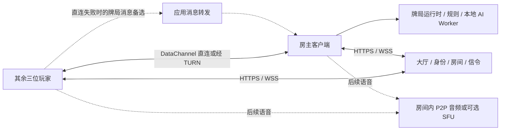

# 熟人 P2P 联机与 Monorepo 演进方案

> 文档类型：候选技术方案；日期：2026-10-15。用户已选择“熟人约局、P2P 与低服务器成本优先”。本文定义架构建议、拆包边界和阶段验收，不表示功能已实现；任务状态统一由[开发路线](development-roadmap.md)维护。

## 1. 推荐决策与当前起点

推荐从“房主权威的熟人房 + WebRTC DataChannel + 轻量大厅/信令 + 中继兜底”开始，未来再增加服务器权威的公开房。浏览器优先验证，复用当前 React / TypeScript / Node / Tauri 技术栈；先模块化单体，按实测瓶颈拆部署进程。

当前代码可复用的基础：

- `src/engine/` 与 `src/cards.ts`：规则、牌张与状态转换；适合作为共享纯规则包。
- `src/workbench/session.ts`：本地完整状态、动作提交、取消与游标；可借鉴，不能直接把含完整 `GameState` 的快照广播。
- `src/ai/decisionObservation.ts`、`src/ai/optimized/observation.ts`：AI 合法观察投影；可复用，玩家网络视图需要独立契约。
- `server/apiHandler.ts`：决策、配置、代理、历史、模拟的 HTTP 入口；当前没有独立权威多人牌局。
- `src/history/`、`server/history/`：历史契约、复盘、SQLite；内部含完整状态与 seed，不能直接充当在线客户端协议。
- 根 `pnpm-workspace.yaml` 已存在，但仅包含 `"."`；当前是单包项目，锁定 `pnpm@9.15.4`。

“服务端转发”必须区分：应用层消息转发、TURN 加密数据包中继、SFU 媒体转发、权威牌局裁判。它们解决不同问题，不能互相替代。

## 2. 权威模式与连接路径分别选择

| 模式 | 谁持有完整牌局与裁决 | 默认连接 | 信任与可用性 | 演进位置 |
| --- | --- | --- | --- | --- |
| 本地单机/练习 | 本机运行时 | 进程内 | 保留当前离线与工作台能力 | 持续维护 |
| 熟人 P2P 房 | 一名玩家的房主运行时 | 客户端到房主的 DataChannel；必要时中继 | 信任房主；房主离线无法继续裁决 | 首个联机主线 |
| 云端托管熟人房 | 服务器运行时 | WSS | 可以承受全部玩家离线；增加算力成本 | 有需求再做 |
| 公开/积分房 | 服务器运行时 | WSS | 玩家收不到暗牌；仍需治理串通等作弊 | 后续独立模式 |

P2P 首版采用房主星形连接：四人牌局只需三个数据连接，所有意图由房主串行裁决。其他玩家只持有本座位视图，不能四端共享完整状态后靠 UI 隐藏。

房主持有完整状态，技术上能读取其他手牌、改规则或伪造结果。DTLS、签名、哈希和 seed 承诺都不能单独消除这一能力。熟人模式应明确“房主裁判”；P2P 战绩标记来源，不直接进入可信积分。无需为首版投入分布式洗牌/多方计算。



大厅房主、牌局权威、语音主持人应是三个独立概念。转让房间管理权限不自动迁移权威牌局。首版权威房主固定至本副结束。

## 3. IPv6、NAT 与中继

使用浏览器标准 ICE，让实际连通性检查决定路径。不要在业务代码里以“有 IPv6”或“锥形 NAT”作为直连成功条件。

| 网络情况 | 预期处理 | 必须保留的边界 |
| --- | --- | --- |
| 同一局域网 | ICE 尝试局域网候选 | AP 隔离等设置仍可能阻断 |
| 双方可达 IPv6 | ICE 尝试 IPv6 候选 | 防火墙、路由和 UDP 策略仍影响连接 |
| IPv4 NAT | STUN 发现映射，ICE 检查/打洞 | 映射与过滤行为、双重 NAT、CGNAT 都影响结果 |
| 一端仅 IPv4、另一端仅 IPv6 | 需要可用地址族路径或中继 | TURN 节点和实现需验证双栈与跨地址族中继能力 |
| 直连失败、UDP 受限 | TURN 中继；牌局可走 WSS 应用转发 | TURN 也不是所有代理/防火墙下必达 |
| Wi-Fi/移动网络切换 | 重新建立 ICE 或 ICE restart，并重同步牌局 | 传输重建不能产生第二个裁判或重复动作 |

STUN 用于发现映射和连通性检查，不承载持续业务流量；TURN 才转发数据。ICE 能同时收集直连和中继候选，不应串行等漫长直连超时后才考虑兜底。具体选择由 ICE 优先级和检查结果决定，可偏好直连，但不保证固定“IPv6 → IPv4 → TURN”的顺序。[ICE 标准](https://www.rfc-editor.org/info/rfc8445/)、[TURN 标准](https://www.rfc-editor.org/info/rfc8656/)

“全锥形/受限锥形/对称 NAT”不足以准确描述真实网络；诊断中记录候选类型、地址族、连接结果与 RTT，比维护一张 NAT 类型推断表更实用。[NAT 行为规范](https://www.rfc-editor.org/info/rfc4787/)

WebRTC 仍需交换 SDP 与 ICE candidates，首版复用已鉴权的 WSS 房间连接做信令。每条信令只能发送给同房间的指定成员，限制大小、速率、过期与重放。[WebRTC 官方连接说明](https://webrtc.org/getting-started/peer-connections)

### 两类兜底如何选择

- **牌局、文字消息**：量小，提供 WSS 应用转发作为低复杂度兜底。转发层不负责裁决，收到请求仍由房主校验；它也不会让已经离线的房主继续运行。若要求该层无法读取消息，需另做应用层端到端加密，普通 WSS 只保护到服务器的一段。
- **WebRTC 数据与语音**：部署成熟 TURN 实现，例如 coturn，不自写打洞/UDP 中继协议。TURN 转发 WebRTC 加密包，不因此获得牌局权威。
- 两类兜底按独立能力接入，不要求首版同时维护全部传输组合。首个可玩房间可以先验证 DataChannel + WSS 转发，随后在语音前完善 TURN，并纳入同一联网测试矩阵。
- 浏览器端把 NAT 映射交给 ICE/STUN。UPnP / NAT-PMP / PCP 属于未来原生客户端的可选优化，不作为浏览器或公网可用性的前置条件。
- TURN 提供 UDP 与 TCP/TLS 入口，必要时评估独立公网 IP 上的 TLS 443；不要假定普通 HTTPS 反代/CDN 能承载 TURN 与 UDP。短期凭证由受控服务签发，长期共享密钥只在服务器。[coturn 配置](https://github.com/coturn/coturn/blob/master/README.turnserver)

## 4. 牌局协议与恢复语义

协议先服务“房主与玩家”，后续服务器权威模式沿用相同意图和视图语义。

| 边界 | 约定 |
| --- | --- |
| 玩家输入 | 发送叫分/定主/扣底/出牌意图，携带 `commandId`、`matchId`、`handId`、`authorityEpoch`、`expectedRevision`；座位由已鉴权连接绑定 |
| 权威提交 | 每房串行检查阶段、轮次、所有权和合法性；同一 `commandId` 重试返回原结果；冲突明确拒绝 |
| 权威输出 | 按接收者生成私有视图或安全事件，带递增 revision；不能把内部事件或提交前后完整状态直接广播 |
| 首次加入/重连 | 先鉴权，再返回本座位快照；若使用增量续传，校验 epoch/revision，窗口失效则重新取快照 |
| 路径切换 | WSS 与 DataChannel 共用逻辑命令身份；传输可重复投递，权威提交必须幂等；首版可先暂停输入、重同步、再启用新路径 |
| 协议演进 | 分开记录 wire protocol、规则集/规则版本、历史格式与应用版本；握手拒绝不兼容组合 |
| DataChannel | 牌局采用可靠有序通道；限制包大小与发送队列，避免把整段录像、原始诊断等大对象塞入 |

`commandId` 去重记录需要覆盖重连窗口；如果宣称房主崩溃后仍能恢复，必须与权威提交一并持久化，不能只存在内存。网络层无需宣称“恰好一次送达”。

身份不能只靠房间号或客户端自报 seat。区分 `userId`、`peerId`、`roomId`、座位、连接实例、重连凭证；绑定信令身份与建立后的数据通道身份。重复登录、抢座、旧连接与重连后的旧消息需要明确拒绝策略。

AI 观察、玩家视图、观战视图、内部完整快照分别定义。AI 仍只使用合法阶段观察；100 分搭档明牌必须在成功扣底后才公开并持续更新。权限检查发生在序列化之前，不能仅用 TypeScript 类型断言裁剪对象。

现有工作台支持撤销、透视、反事实分支；在线牌局不提供这些权限。在线 UI 通过视图驱动，不能继续持有全量 `GameState` 并复用调试开关。

## 5. AI 替补与房主故障

首版 AI 替补由房主本地运行，搜索放 Web Worker，避免卡住连接与 UI。使用已有可用引擎及合法回退，不在此次架构迁移中替换默认引擎或声称牌力提升。

```text
座位控制：人工在线 → 断线宽限 → AI 托管 → 人工申请回归 → 原子交还
```

- AI 只是另一种动作来源，走同一合法提交入口，不能直接改状态。
- 超时由权威房主计算；传给客户端截止时间作展示，客户端倒计时不裁决。
- 为每次 AI 请求绑定 hand、revision、座位控制代次；人工回归或局面变化后取消请求，拒绝迟到结果。
- AI 总预算含排队、搜索/网络与校验；超过剩余回合预算，用合法的低成本回退。复杂搜索与实验任务不能阻塞房间消息循环。
- 显示固定的房间 AI 策略与实际托管状态。公开/积分房未来禁止玩家自行更换线上 AI 或申请隐蔽提示；熟人房可提前约定辅助规则。
- 首版尽量使用房主本地搜索，云端 LLM 作为可选高成本能力，不把模型密钥发给其他客户端。

**房主掉线不同于普通玩家掉线。** 房主不在线时，本地 AI 也无法替它继续裁决。建议首版暂停并保留重连宽限；不能恢复则本副中止、不计胜负，由新房主重新发新牌，不复用已泄漏的牌序。刷新/崩溃恢复若要支持，需在房主持久化权威日志和快照；浏览器后台冻结与设备休眠仍需测试。

完整无损主机迁移需要安全移交暗牌/seed、日志与去重状态、唯一权威代次和防双主，不能把完整状态预发给所有人。云端持续托管同样需要服务器持有完整状态并接管裁判，应作为云端权威模式单独实现。

## 6. 大厅、聊天和语音

### 大厅最小闭环

先实现游客/轻身份、邀请链接或房间码、四座/搭档选择、准备/开局、房间可见性、离开与重连。房间成员由服务器管理，牌局状态由房主管理；服务器不信任房主上报的“在线人数”替代成员授权。小规模用 Node 模块化单体，SQLite 保存账号/房间元数据和必要索引；在线连接和短期 presence 可先放内存，并明确重启后需重新注册。

邀请令牌应有过期与撤销机制，房间码不可作为长期身份凭据；限流防枚举。暂不把好友系统、排行榜、自动匹配、公会都塞进首个大厅。

### 文字聊天

房间文字首版走 WSS，便于迟到成员、掉线恢复、屏蔽与限流；保留短窗口，不默认永久保存。定义消息身份、长度限制、发送频率、静音/举报与保留策略；文字和系统事件分开渲染，用户文本不作为 HTML 执行。若加入私聊，需要另做参与者鉴权。

### 四人语音

首个语音版本可采用房间内全互联：四人共六条双向 peer 连接，每人向三人发送音频；与房主星形牌局连接分开考虑。TURN 能兜底其中失败的路径，但不混音、不自动减少这些媒体副本。

先提供按住说话/开关麦、本地静音、设备选择和连接提示，验证回声消除、蓝牙耳机、权限拒绝、音频焦点、网络切换和后台行为。默认不录音；语音故障不阻止出牌。技术上允许说话不等于游戏规则允许报牌，要明确房间约定。

当移动端上行/电量、多人观战、集中管理或媒体质量成为实际问题，再比较 SFU。SFU 将客户端的上传集中到媒体服务，增加服务器带宽；可以评估 LiveKit 等成熟方案，不自研媒体栈。SFU 与 TURN 职责不同，SFU 仍可能需要 TURN。[LiveKit 自托管与端口文档](https://docs.livekit.io/transport/self-hosting/ports-firewall/)

P2P 会让对端获得连接所需的网络地址信息。熟人房应说明这一点；提供强制中继作为可选隐私模式，并接受流量成本。公开陌生人房优先服务端路径。WebRTC 传输加密不等于 SFU、应用转发或录制端都无法接触内容；是否需要额外媒体 E2EE 必须独立选择。[WebRTC 标准](https://www.w3.org/TR/webrtc/)

## 7. pnpm workspace 包边界

按职责与运行环境拆包，包数量不等于部署服务数量。下面是逐步形成的目标目录，不要求第一次迁移全部建齐。

```text
apps/
  web/                  React / Vite；同时供 Tauri 加载
  server/               Node：大厅、信令、应用转发、现有 API 与存储适配
  desktop/              后期需要独立发布节奏时再放 Tauri 外壳
  ai-worker/            云端权威模式的可选独立 AI 进程，后置
packages/
  game-core/            牌张、纯规则、动作与确定性状态转换
  game-view/            玩家/观战/AI 投影、合法观察与可见性规则
  protocol/             版本化网络 DTO、运行时编解码与校验
  match-runtime/        权威牌局、串行提交、回合时钟、座位控制与失效
  ai-core/              引擎契约、搜索、启发式、profile 领域模型
  client-sdk/           联机会话、重连同步、WSS/DataChannel 传输适配
  history-core/         历史契约、纯复盘、版本与迁移边界
  ui/                   两个以上界面真实复用后再提取 React 组件
  ai-eval/              评测、对战与固定数据；后置迁移，不进客户端依赖
  tooling/              出现重复配置后再提取共享工具配置
infra/
  coturn/               TURN 部署模板、端口与运维说明，不是 JS 包
  media/                可选 SFU 部署模板，不是自研媒体实现
tests/                  跨包行为、信息隔离、联机与端到端测试
docs/
experiments/            独立配置，保持与常规测试/发版隔离
```

### 关键职责与依赖方向

| 包/应用 | 依赖与边界 | 当前来源及迁移注意点 |
| --- | --- | --- |
| `@yaozifen/game-core` | 无 UI/网络/AI 依赖；注入随机来源，在线 seed 由权威安全生成 | `src/cards.ts` + `src/engine/`，不能只搬 engine 而漏掉 cards |
| `@yaozifen/game-view` | 只依赖 core；拥有投影和纯观察类型 | 从 AI 目录移出通用投影；去除观察契约对搜索实现目录的依赖 |
| `@yaozifen/protocol` | 依赖 core/view；无 React、SQL、具体引擎实现 | 显式区分 wire DTO 与完整状态；AI RPC 用独立导出入口 |
| `@yaozifen/match-runtime` | 依赖 core/view；通过端口注入时钟、存储和决策器 | 借鉴 GameSession，分离工作台撤销/分支与线上权威语义 |
| `@yaozifen/ai-core` | 依赖 core/view；算法与领域模型不依赖客户端 SDK | 浏览器 Worker、HTTP/模型调用按适配器/导出入口隔离；必要时再拆 ai-node |
| `@yaozifen/client-sdk` | 依赖 protocol/view；管理客户端副本，不持有全量权威状态 | 从 useGame 分离在线控制器；本地模式走独立适配器 |
| `@yaozifen/history-core` | 依赖 core/view；SQL 与 HTTP 留在应用适配层 | 先解除 contracts 对 workbench/session、AI 实现类型的反向引用 |
| `apps/web` | 组合 UI、SDK、离线运行时与浏览器 AI | 在线页面不加载云端密钥、Node 存储或评测数据 |
| `apps/server` | 组合协议、存储、鉴权、信令；后续可加载权威运行时与 AI | 初期内部按 lobby/signaling/relay/history/decision 分模块，不拆微服务 |

运行时端口定义归拥有该用例的模块，具体适配在应用组合根注入。core 不反向依赖 protocol；runtime 不依赖 React/WSS/WebRTC；ai-core 不反向依赖 match-runtime。`game-core` 可以在客户端用于规则提示，但服务器权威模式不能据此信任客户端判断。

一个包只有 Node 与浏览器适配差异时先用明确子路径导出；当依赖体积、隔离要求或独立发布形成真实边界，再拆包。避免万能 `shared` / `common` / `utils` 包，也避免为每个引擎、每种传输或每个房间功能建包。

### Workspace 与构建约定

```yaml
# 目标示意，实施时保留并核对当前 pnpm 版本的已有配置
packages:
  - apps/*
  - packages/*
```

```json
{
  "private": true,
  "dependencies": {
    "@yaozifen/game-core": "workspace:*",
    "@yaozifen/game-view": "workspace:*"
  }
}
```

上面的依赖片段属于消费它们的工作区包，不是让根包集中声明全部依赖。每包声明自己的依赖，根包保留编排脚本和共用开发工具。使用 `workspace:*` 保证内部依赖解析到本地工作区；保留根 lockfile。[pnpm workspace 文档](https://pnpm.io/workspaces)

- 先保持锁定的 pnpm 版本，不把包迁移与包管理器大版本升级混成一批；参考文档的新配置须确认 9.15.4 支持后再用。
- `exports` 限定公共入口，禁止跨包 `../../src` 与内部深层导入。浏览器构建不得经 barrel 导入拉入 SQLite、Node SDK 或模型凭据。
- core/view/runtime 的 TS 配置不包含 DOM/React 环境；Node 与浏览器分别配置。根共享 strict 规则，不强行共用所有 lib/types。
- 纯 TS 包初期可由 Vite/服务端构建器处理源码导出；生产 Node 必须打包产物或先构建 JS，不能默认 Node 能执行当前所有 TS 写法和路径。
- 根 `pnpm test` 保持完整测试语义，包含 `tests/` 跨包测试；根 `pnpm build` 覆盖所有交付包和应用。递归脚本避免包含根包导致自调用，不能只跑各包而遗漏根测试。
- 初期继续把测试放 `tests/`，遵循现有 AGENTS；如以后采用包内 `tests/`，先同步约定与统一发现规则。
- AI eval 与 experiments 的数据、配置、seed 和结果指纹有追溯要求；包移动可能改变源码指纹，记录迁移前后身份，不混合续跑结果。
- 首批保留根 `src-tauri/`，明确调整其 `frontendDist`、构建命令、schema 路径与权限配置；稳定后才考虑移动到 `apps/desktop`，无需再建一份 React 牌桌。
- 暂不引入 Nx/Turborepo、多版本发布系统或私有 npm 仓库；出现 CI 耗时或对外发包需求再选择。

## 8. 分阶段推进与验收

以下是此方向内部的依赖顺序，不覆盖已有产品/AI 任务的优先级，也不承诺日历工期。

| 阶段 | 交付切片 | 进入下一阶段的证据 |
| --- | --- | --- |
| M0：拆出共享基础 | 先 core 与 view，再 web/server 应用边界；protocol 随联机契约加入 | 单机/练习/复盘/模拟保持行为；全量 test/build；浏览器产物无 Node 专有模块 |
| M1：最小熟人联机 | 轻身份、邀请房、座位准备；固定房主；DataChannel 星形；WSS 信令与消息兜底；房主本地 AI | 跨真实网络四人打一完整副；普通客户端抓包无暗牌/seed；重复/过期/越权动作拒绝；普通座位掉线可托管 |
| M2：连接可靠性 | TURN、双栈、恢复窗口、路径切换、房主故障反馈与网络诊断 | 强制 relay 实际通过；禁 UDP、CGNAT、IPv4/IPv6、重连与切网矩阵；无重复提交与双主；不能恢复时明确中止 |
| M3：社交与语音 | 文字可在 M1 后并行；语音在 M2 兜底稳定后接入 P2P mesh | 四人耳机/免提、权限拒绝、静音、丢包、后台与语音失败不影响出牌；记录带宽/电量与质量 |
| M4：按需要扩展 | Tauri 目标端、云端托管/公开房、可选 SFU、多实例 | 各自目标端与负载实测；公开房独立权威与信息隔离；成本数据支持部署拆分 |

M0 中先拆 core；view 边界稳固后再拆 runtime/AI/history，不要求所有包先拆完才交付联机。每批提交同时保持现有开发入口可用，禁止一口气全仓搬迁并同时重写状态管理与网络。

新增联机行为仍按 TDD：先写能复现目标缺陷的中文行为测试并观察正确红灯，再实现。覆盖信息隔离、100 分公开时机、总分守恒、锁定线 `105 - B`、重复动作、跨副迟到 AI、人工接管竞态、断线与显式故障注入。网络实验不能用“本机两个标签页成功”代替公网验收。

## 9. 容易遗漏的成本、风险和运营边界

| 事项 | 建议 |
| --- | --- |
| P2P 的真实节省 | 节省的是成功直连部分的中继流量；大厅、信令和兜底仍要服务器。牌局消息可能很小，优先测量语音和云端 AI 成本 |
| TURN 成本 | 按实际 relay 比例、每人媒体副本、码率、在线时长与供应商出网口径测量；四人 mesh 失败多时，中继成本可能明显增加 |
| 原生平台差异 | Tauri WebView、麦克风权限、音频焦点、后台冻结和 Linux 媒体依赖逐端实机验证；有打包入口不等于 WebRTC 已兼容 |
| 发牌随机性 | 当前本地 Date.now 路径不能直接作为线上可信发牌方案；权威端使用安全随机来源，seed 不进入玩家快照或日志 |
| 历史/观战泄漏 | 正在进行的记录按座位投影；结束后是否公开全牌单独约定，防止影响同一副/同一牌序仍在进行的其他对局 |
| 服务器安全 | TURN 短凭证、限额、鉴权；阻断对内网/保留地址的不当中继；信令/聊天限流；敏感 SDP/IP/token 脱敏，日志明确保留期 |
| 客户端安全 | 收紧生产 Tauri CSP/能力权限，防止在线聊天和远端内容扩大本地权限；线上入口不暴露本地开发/模拟管理接口 |
| 状态恢复 | 区分玩家重连、房主进程恢复、服务器重启、服务实例迁移；每项单独声明支持范围，不用一个“自动恢复”概括 |
| 公平边界 | 熟人房主可信假设、AI 辅助、弃局处理、串通报牌与未来积分规则提前说明；传输加密解决不了合谋 |
| 多实例 | 出现需要时加房间路由、唯一 owner/lease/fencing、持久化提交；Redis 可做 presence/路由缓存，不能仅靠 Pub/Sub 当可靠牌局日志 |
| 可观测性 | 记录直连/relay/WSS 占比、连接耗时、重连成功率、动作确认延迟、AI 托管/超时率、服务器出网和语音质量；按目标设备与网络分组 |

先采集真实好友局数据，再决定是否需要 SFU、独立 AI worker、PostgreSQL、Redis 或多区域部署。初期可在同一台主机用独立进程/容器部署 Node 与 coturn；隔离资源限额与监控，避免 AI 搜索或中继带宽拖垮大厅。

## 10. 建议第一批实施范围

1. 先保存迁移前 `pnpm test` / `pnpm build` 基线，抽取 `game-core` 与 `game-view`，保留现有入口；整理动作/历史契约反向依赖。
2. 定义房主权威的最小 wire 协议与玩家视图；用测试证明不同玩家收不到暗牌与 seed，并校验旧命令、重复命令和越权动作。
3. 做四座邀请房切片：房主本地运行时 + 三个远端玩家 + 本地 AI 替补；先可完整打完，再补联网矩阵与 TURN。

首批不承诺无损房主迁移、无服务器全离线发现、公开排位公平、所有平台后台常驻或零中继成本。这些能力都需要额外机制与对应验收。
